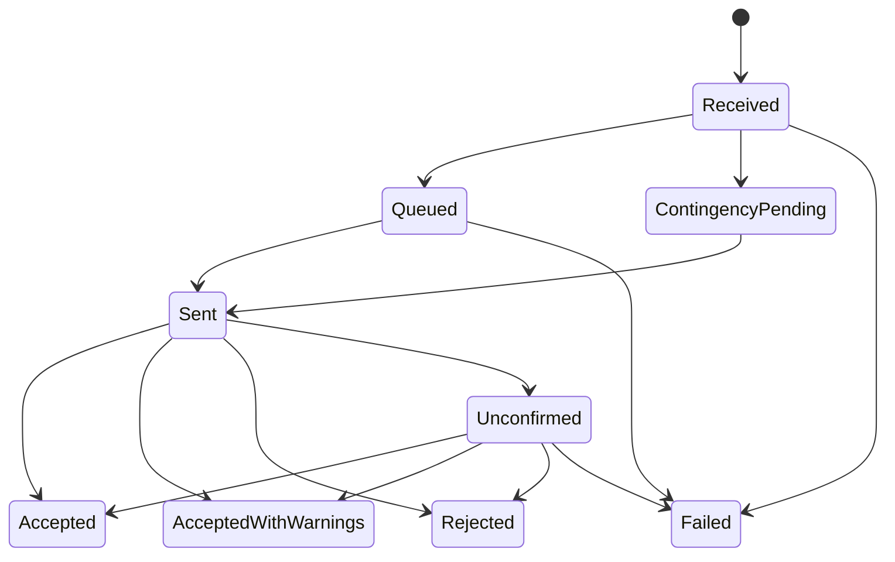

# Modelo de datos detallado

Este documento es la especificación de implementación del modelo. Parte del esquema real del PHP (134 migraciones del repo Community) y lo reemplaza por un modelo limpio, multi-tenant y portable a PostgreSQL, SQL Server y MySQL. Donde algo no se pudo confirmar en el código origen se marca **\[verificar\]** y se resuelve con los golden tests.

## 1. Principios

1. **Un modelo lógico, tres proveedores.** Las entidades y configuraciones EF son idénticas; solo cambian los tipos físicos y unos pocos índices (sección 8).
2. **Todo dato de negocio lleva `company_id`.** Las FKs entre tablas de tenant son compuestas `(company_id, id)` para que una fila no pueda apuntar a otra empresa.
3. **Catálogos DIAN con los mismos ids numéricos que el PHP.** El contrato JSON envía `type_document_id: 1`, `tax_id: 1`, etc., así que los ids se siembran explícitos y no se autogeneran.
4. **Nada de blobs ni secretos en filas calientes.** XML, PDF, solicitud y respuesta de la DIAN van a `IBlobStorage`; certificados y claves a `ICertificateStore`/cifrado de aplicación.
5. **Dinero y cantidades en `decimal` exacto**, nunca `float`. El PHP mezcló `float(10,2)`, `decimal(10,2)` y `decimal(18,2)` en `documents`; aquí hay un solo estándar.
6. **Sin `ON DELETE CASCADE` hacia datos fiscales.** Los documentos emitidos no se borran: se anulan con nota o se marcan `deleted_at` (borrado lógico solo para entidades administrativas; las vistas previas no se persisten).
7. **Fechas en UTC** (`DateTimeOffset` en código). La fecha/hora de emisión del documento se guarda como instante UTC y además `issue_date`/`issue_time` en hora Colombia (UTC-5) porque eso es lo que va al XML.

## 2. Convenciones

| Tema | Regla |
| --- | --- |
| Nombres | `snake_case` en tablas y columnas, tablas en plural. Se aplica con una convención global de EF (no a mano). Los catálogos conservan el nombre del PHP (`type_documents`, `taxes`, …) para que `/table/*` mapee 1:1. |
| Claves de tenant | `id uuid` (v7, generado en la aplicación). |
| Claves de catálogo | `id int` explícito (los de la DIAN/PHP). |
| Claves de alto volumen sin exposición externa | `bigint identity` (`audit_logs`). |
| Columnas comunes en tablas de tenant | `company_id uuid not null`, `created_at ts not null`, `updated_at ts not null`, `row_version bigint not null` (concurrencia optimista; la incrementa un interceptor de `SaveChanges`, igual en los 3 motores). |
| Borrado lógico | Solo donde se indica con `deleted_at ts null`; filtro global EF. |
| Texto normalizado | Se guarda normalizado y se compara ordinal: NIT solo dígitos, email en minúsculas, prefijo en mayúsculas, CUFE/CUDE en hex minúsculas. Así no se depende de la collation de cada motor. |
| Booleanos | `bool` real; el PHP usaba `tinyint`. |
| Enums | `smallint` con enum C#; tabla de referencia solo si el panel la necesita. |
| JSON | Solo para datos que no se consultan por campo (snapshots, extensiones). Si se consulta por campo, es columna. |
| Nombres de índices | `ix_<tabla>_<cols>`, `ux_<tabla>_<cols>`, `fk_<hija>_<padre>`, `ck_<tabla>_<regla>`. |

### Tipos lógicos

`uuid`, `int`, `smallint`, `bigint`, `bool`, `varchar(n)`, `text`, `date`, `ts` (instante UTC), `numeric(p,s)`, `json`, `bytes`. La tabla de la sección 8 da el tipo físico por motor.

- Importes de documento: `numeric(18,2)`.
- Precio unitario y cantidades: `numeric(18,6)`.
- Porcentajes y tarifas: `numeric(9,4)`.
- CUFE/CUDE/CUNE: `varchar(96)` (SHA-384 en hex).

## 3. Módulos y tablas

Notación: `columna tipo [null] — nota`. `PK`, `FK`, `UQ`, `IX`, `CK` indican restricciones. Las columnas comunes de la sección 2 se omiten salvo que cambien.

### 3.1 Catálogos DIAN (módulo `Catalog`)

Todas estas tablas comparten la forma base, con las columnas extra indicadas:

```
<catalogo>
  id            int       PK      — id explícito, igual al del PHP
  code          varchar(20) not null  — código DIAN
  name          varchar(255) not null
  is_active     bool not null default true
  valid_from    date null           — vigencia DIAN (nuevo)
  valid_to      date null
  UQ ux_<catalogo>_code (code)  — salvo municipalities, unit_measures, type_operations, countries y languages (ver abajo)
```

| Tabla (origen PHP) | Extras |
| --- | --- |
| `type_documents` | `cufe_algorithm varchar(16) null` (`CUFE-SHA384` tiene 11 caracteres), `prefix varchar(10) null`. El PHP tiene 14 filas (ids 1–14); el id 6 (ZIP) tiene `code` vacío, que no es nulo. |
| `taxes` | `description varchar(255)`. El id 15 es «ZZ» (no aplica); el PHP corrigió su nombre en 3 migraciones, se siembra ya corregido. |
| `type_regimes`, `type_organizations`, `type_liabilities`, `type_environments`, `type_currencies`, `unit_measures`, `type_operations`, `type_discounts`, `discounts`, `reference_prices`, `payment_forms`, `payment_methods`, `type_rejections`, `events`, `incoterms`, `prepaid_payment_types`, `type_generation_transmitions`, `type_spds`, `languages` | solo forma base |
| `type_document_identifications` | `rips_code varchar(10) null` (migración `add_field_code_rips`). |
| `type_item_identifications` | `code_agency varchar(10) null`: el XML lo escribe como `schemeAgencyID`. |
| `unit_measures`, `type_operations` | Códigos repetidos en el PHP (MGM, ONZ, PD y SO en unidades; 10 y 11 en operaciones, reusados por el documento soporte): índice no único `ix_<catalogo>_code` en lugar de `UQ`. |
| `health_type_document_identifications` | solo forma base (Enterprise RIPS; se omite en la paridad Community). |
| `credit_note_discrepancy_responses`, `debit_note_discrepancy_responses`, `credit_note_discrepancy_responses_sd` | solo forma base; tres tablas porque los códigos difieren por documento. |
| `countries` | `code varchar(5)` (ISO). Índice no único: el PHP repetía `SI` en Suecia (id 218); la semilla lo corrige a `SE`, pero el índice no se vuelve único para no romper la paridad si aparece otro duplicado. |
| `languages` | 185 pares de códigos que solo difieren en mayúsculas (`aa`/`AA`): índice no único, porque SQL Server y MySQL comparan sin distinguir mayúsculas. |
| `departments` | `country_id int FK`, `code`. |
| `municipalities` | `department_id int FK`, `code varchar(10)`, `codefacturador bigint null` (corregido en 8 migraciones PHP; se carga el valor final). `UQ (department_id, code)`. |

Nota: `type_environments` id 1 = producción, id 2 = habilitación (así lo usa `PUT /config/environment`).

### 3.2 Plataforma e identidad (módulo `Identity`)

```
resellers                      — PHP: administrators
  id uuid PK, identification_number varchar(20) UQ, dv char(1) null,
  name varchar(255), address varchar(255) null, phone varchar(30) null,
  email varchar(255) UQ, contact_name varchar(255) null, plan_label varchar(100) null,
  is_active bool default true, observation varchar(500) null

users                          — ASP.NET Identity (AspNetUsers) con nombres snake_case
  id uuid PK, email varchar(255) UQ(normalizado), password_hash varchar(500),
  name varchar(255), phone varchar(30) null, reseller_id uuid null FK resellers,
  is_active bool, email_confirmed bool, lockout_end ts null, access_failed_count int,
  security_stamp varchar(100)
  — SIN api_token, SIN mail_*: se movieron a api_keys y company_mail_settings

roles                          — Identity. Semilla: platform_admin, reseller, owner, seller, customer
user_roles (user_id, role_id)  PK compuesta

user_companies                 — PHP: company_user
  id uuid PK, user_id uuid FK, company_id uuid FK, role_id uuid FK roles,
  customer_id uuid null      — solo para rol customer (portal del cliente)
  UQ (user_id, company_id, role_id)

api_keys
  id uuid PK, company_id uuid null FK   — null = llave de plataforma (reemplaza X-Admin-Token)
  name varchar(100), key_prefix varchar(12), key_hash char(64) UQ  — SHA-256 hex
  scopes varchar(500)        — lista separada por coma: documents:write, documents:read, config:write, …
  expires_at ts null, last_used_at ts null, revoked_at ts null, created_by uuid FK users
  IX (company_id, revoked_at)

refresh_tokens
  id uuid PK, user_id uuid FK, token_hash char(64) UQ, expires_at ts, revoked_at ts null,
  replaced_by uuid null, created_ip varchar(45) null, user_agent varchar(300) null

password_reset_tokens          — sin equivalente en el PHP (fase 5, migración PasswordResetTokens)
  id uuid PK, user_id uuid FK users, token_hash char(64) UQ  — SHA-256 hex del token del enlace
  expires_at ts (30 min), used_at ts null, revoked_at ts null  — revocado al pedir otro enlace
  requested_ip varchar(45) null, created_at ts, updated_at ts, row_version bigint
  IX (user_id)
```

Reglas: la clave en claro se muestra una sola vez al crearla; solo se guarda `key_hash`. Una llave con `company_id` solo opera sobre esa empresa (la regla «el NIT debe pertenecer a la empresa del token» del manual).

### 3.3 Empresa y configuración (módulo `Company`)

```
companies                      — PHP: companies (+ nombre/correo que vivían en users)
  id uuid PK, reseller_id uuid null FK
  identification_number varchar(20) UQ  — NIT sin DV, solo dígitos
  dv char(1)
  name varchar(255)            — razón social (en el PHP vive en users.name; confirmado en «php-rules»)
  email varchar(255), phone varchar(30), address varchar(255)
  merchant_registration varchar(50) null
  language_id int FK, country_id int FK, municipality_id int FK
  tax_id int FK, type_currency_id int FK, type_operation_id int FK
  type_document_identification_id int FK, type_organization_id int FK,
  type_regime_id int FK
  storage_mode smallint null   — 0 local, 1 nube (migración add_storage_mode)
  graphic_representation_template int default 2
  allow_seller_login bool default false
  is_active bool default true
  — SIN password/newpassword, SIN type_plan*_id, SIN *_type_environment_id (van en tablas hijas)

company_liabilities            — reemplaza type_liability_id + type_liability_ids (json)
  company_id uuid FK, type_liability_id int FK    PK (company_id, type_liability_id)

company_environments           — reemplaza 5 columnas *_type_environment_id
  id uuid PK, company_id FK, document_kind smallint, type_environment_id int FK
  UQ (company_id, document_kind)
  document_kind: 1 factura/notas, 2 nómina, 3 documento equivalente, 4 documento soporte, 5 eventos

company_software               — PHP: software (una fila con 5 juegos de columnas)
  id uuid PK, company_id FK, document_kind smallint, type_environment_id int FK
  software_identifier varchar(64), pin_cipher varchar(512)  — PIN cifrado
  dian_url varchar(255), test_set_id varchar(64) null
  UQ (company_id, document_kind, type_environment_id)

certificates
  id uuid PK, company_id FK, name varchar(255)
  secret_ref varchar(512)      — clave en Key Vault/Secrets Manager/Secret Manager o ruta cifrada
  thumbprint varchar(64), subject varchar(500), issuer varchar(500)
  not_before ts, not_after ts, is_active bool, uploaded_by uuid FK users
  UQ filtrado ux_certificates_active (company_id) WHERE is_active = true
  IX ix_certificates_not_after (not_after)   — alertas de vencimiento

resolutions
  id uuid PK, company_id FK, document_type_id int FK
  type_environment_id int FK   — columna añadida tarde en el PHP; aquí obligatoria
  prefix varchar(10) null, resolution_number varchar(50), resolution_date date
  technical_key varchar(128) null, range_from bigint, range_to bigint
  valid_from date null, valid_to date null, is_active bool
  CK ck_resolutions_range (range_from <= range_to)
  IX (company_id, document_type_id, type_environment_id, is_active)

company_mail_settings
  company_id uuid PK/FK, use_platform_default bool
  host varchar(255) null, port int null, username varchar(255) null,
  password_cipher varchar(512) null, encryption varchar(10) null,
  from_address varchar(255) null, from_name varchar(255) null

company_whatsapp_settings          — Enterprise (fase 8): no se crea en la migración inicial
  company_id uuid PK/FK, url varchar(255) null, token_cipher varchar(512) null

company_logos                  — una fila por empresa; el archivo va a blob
  company_id uuid PK/FK, storage_key varchar(500), content_type varchar(100), updated_at ts
```

Cifrado de `*_cipher`: ASP.NET Data Protection con llave en el proveedor de secretos (o llave maestra AES-GCM en instalaciones sin nube). Nunca se registran en logs ni en `audit_logs.changes`.

### 3.4 Terceros y productos (módulo `Masters`)

```
customers                      — PHP: customers (la PK era el NIT; luego se agregó companies_id)
  id uuid PK, company_id FK
  identification_number varchar(20), dv char(1) null
  type_document_identification_id int FK, name varchar(255)
  phone varchar(30) null, address varchar(255) null, email varchar(255) null
  municipality_id int null FK, type_organization_id int null FK,
  type_regime_id int null FK, type_liability_id int null FK,
  merchant_registration varchar(50) null, is_active bool default true, deleted_at ts null
  — desactivar = is_active false; la API no usa deleted_at (el UQ incluye las filas borradas)
  UQ (company_id, id)           — destino de FKs compuestas
  UQ (company_id, type_document_identification_id, identification_number)
  — SIN password/newpassword (el portal usa Identity)
  — Semilla por empresa: consumidor final (NIT 222222222222, tipo 13) al crear la empresa

items                          — PHP: items (solo el subconjunto Community)
  id uuid PK, company_id FK, code varchar(100), name varchar(500),
  description varchar(1000) null, unit_measure_id int FK, type_item_identification_id int FK,
  sale_unit_price numeric(18,6), tax_id int null FK,
  tax_percent numeric(9,4) null, tax_per_unit_amount numeric(18,6) null   — fase 5 (migración ItemTaxRate)
  is_active bool, deleted_at ts null
  UQ (company_id, code)         — en PHP name e internal_id eran únicos GLOBALES (bug en multi-empresa)
  — Stock, lotes, series, comisiones, imágenes: Enterprise (POS); no se crean en la paridad Community
```

### 3.5 Documentos (módulo `Documents`)

El núcleo. `documents` pasa de 77 columnas planas a una cabecera más tablas hijas.

```
documents
  id uuid PK, company_id FK
  document_type_id int FK type_documents
  type_environment_id int FK         — ambiente en que se emitió
  resolution_id uuid null FK         — null para nómina/soporte sin resolución
  prefix varchar(10) not null default '', number bigint, full_number varchar(30)  — prefijo+número
  status smallint not null           — enum DocumentStatus (sección 4)
  cufe varchar(96) null              — CUFE, CUDE o CUNE según tipo
  uuid_algorithm varchar(10) null    — CUFE-SHA384 / CUDE-SHA384 / CUDS-SHA384
  issue_date date, issue_time time   — hora Colombia, tal como va en el XML
  issued_at ts                       — mismo instante en UTC (consultas y orden)
  customer_id uuid null              — FK compuesta (company_id, customer_id)
  customer_snapshot json             — copia congelada: el XML depende de estos datos, no del cliente vivo
  currency_id int FK, exchange_rate numeric(18,6) null
  type_operation_id int null FK
  line_extension_amount numeric(18,2), tax_exclusive_amount numeric(18,2),
  tax_inclusive_amount numeric(18,2), allowance_total_amount numeric(18,2) default 0,
  charge_total_amount numeric(18,2) default 0, prepaid_amount numeric(18,2) default 0,
  payable_amount numeric(18,2)       — reemplaza sale/subtotal/total/total_discount/total_tax
  reference_document_id uuid null    — nota -> documento original (FK compuesta)
  discrepancy_code int null          — código de concepto de la nota (1,2,3…)
  discrepancy_description varchar(500) null, notes varchar(2000) null
  head_note varchar(2000) null, foot_note varchar(2000) null
  track_id varchar(64) null, dian_status_code varchar(10) null,
  dian_status_description varchar(500) null, sent_at ts null, accepted_at ts null
  email_status smallint default 0, email_sent_at ts null
  pdf_template_id int null
  extensions json null               — exportación, AIU, mandato, transporte, contingencia
  created_by_type smallint, created_by_id uuid null  — usuario o api key
  deleted_at ts null                 — [verificar] sin uso mientras `Draft` no se persista; se elimina si la fase 2 no le encuentra uso
  UQ ux_documents_number (company_id, document_type_id, type_environment_id, prefix, number)
  UQ filtrado ux_documents_cufe (company_id, cufe) WHERE cufe IS NOT NULL
  UQ (company_id, id)
  IX ix_documents_company_issued (company_id, issued_at DESC)
  IX ix_documents_company_status (company_id, status)
  IX ix_documents_customer (company_id, customer_id, issued_at DESC)
  IX ix_documents_track (track_id) WHERE track_id IS NOT NULL
```

Nota sobre `ux_documents_number`: `prefix` puede ser NULL (documentos sin prefijo). Se guarda cadena vacía en vez de NULL cuando no hay prefijo, para que el único funcione igual en los tres motores.

```
document_lines
  id uuid PK, company_id, document_id uuid FK(company_id, document_id)  — sin cascada (principio 6)
  line_number int, code varchar(100) null, description varchar(500), notes varchar(1000) null
  type_item_identification_id int FK, unit_measure_id int FK
  quantity numeric(18,6), base_quantity numeric(18,6), unit_price numeric(18,6),
  line_extension_amount numeric(18,2), free_of_charge bool, reference_price_id int null FK
  extensions json null               — datos propios de la línea (AIU, transporte, mandato)
  UQ (document_id, line_number)

document_taxes                     — totales de impuesto de cabecera (tax_totals)
  id uuid PK, company_id, document_id FK, tax_id int FK,
  percent numeric(9,4) null, taxable_amount numeric(18,2), tax_amount numeric(18,2)
  IX (document_id)

document_line_taxes                — impuestos por línea
  id uuid PK, company_id, document_id, line_id uuid FK, tax_id int FK,
  percent numeric(9,4) null, taxable_amount numeric(18,2), tax_amount numeric(18,2),
  per_unit_amount numeric(18,6) null, unit_measure_id int null FK
  IX (line_id)

document_allowance_charges         — descuentos y cargos (de cabecera si line_id es null)
  id uuid PK, company_id, document_id FK, line_id uuid null FK,
  charge_indicator bool, discount_id int null FK, reason varchar(500) null,
  amount numeric(18,2), base_amount numeric(18,2), multiplier_factor numeric(9,4) null

document_payments
  id uuid PK, company_id, document_id FK, payment_form_id int FK,
  payment_method_id int FK, due_date date null, duration_measure varchar(20) null

document_references                — billing_reference, order_reference, etc.
  id uuid PK, company_id, document_id FK, kind smallint,
  number varchar(50) null, uuid varchar(96) null, issue_date date null

document_files                     — sustituye xml/pdf/request_api/response_* de documents
  id uuid PK, company_id, document_id FK, kind smallint, revision int default 1
  storage_provider smallint, storage_key varchar(500), content_type varchar(100),
  size_bytes bigint, sha256 char(64), created_at ts
  kind: 1 xml firmado, 2 xml AttachedDocument, 3 pdf, 4 solicitud json,
        5 respuesta DIAN, 6 zip enviado, 7 ApplicationResponse
  UQ (document_id, kind, revision)

dian_submissions                   — un registro por intento contra la DIAN
  id uuid PK, company_id, document_id FK, attempt int, operation smallint
  type_environment_id int, track_id varchar(64) null, zip_key varchar(64) null
  http_status int null, dian_status_code varchar(10) null,
  dian_status_description varchar(500) null, is_valid bool null,
  error_messages json null, request_file_id uuid null, response_file_id uuid null
  started_at ts, finished_at ts null, duration_ms int null
  operation: 1 SendBillSync, 2 SendTestSetAsync, 3 GetStatus, 4 GetStatusZip, 5 SendEvent
  UQ (document_id, attempt)  IX (track_id)

document_events                    — eventos RADIAN emitidos o recibidos
  — PHP: campos acu_recibo, rec_bienes, aceptacion, rechazo, cude_*, payload_* en documents y received_documents
  id uuid PK, company_id, document_id uuid null FK, received_document_id uuid null FK
  event_id int FK events, cude varchar(96), issued_at ts, track_id varchar(64) null
  status smallint, dian_status_code varchar(10) null, payload_file_id uuid null
  UQ (company_id, cude)  IX (document_id)  IX (received_document_id)
  CK ck_document_events_target: exactamente uno de document_id / received_document_id no es nulo

received_documents                 — facturas recibidas de proveedores
  id uuid PK, company_id FK, supplier_identification_number varchar(20), supplier_dv char(1),
  supplier_name varchar(255), document_type_id int FK, prefix varchar(10) not null default '',
  number varchar(20), cufe varchar(96), issue_date date, type_environment_id int FK
  line_extension_amount numeric(18,2), tax_exclusive_amount numeric(18,2),
  allowance_total_amount numeric(18,2), tax_amount numeric(18,2), payable_amount numeric(18,2)
  xml_file_key varchar(500) null, pdf_file_key varchar(500) null
  UQ (company_id, cufe)  IX (company_id, issue_date DESC)  IX (company_id, supplier_identification_number)

numbering_sequences                — PHP: sends (consecutivo por resolución; ver scope_key)
  id uuid PK, company_id FK, scope_key varchar(120), next_number bigint, row_version
  UQ (company_id, scope_key)
  scope_key = "R:{resolution_id}" cuando hay resolución, o "T:{document_type_id}:{env}:{prefix}:{year}" si no
```

### 3.6 Planes y consumo (módulo `Billing`)

```
plans                              — PHP: plans/type_plans
  id int PK, name varchar(100) UQ, period smallint (0 default, 1 mensual, 2 anual, 3 paquete),
  is_active bool, observations varchar(500) null
plan_quotas                        — reemplaza qty_docs_invoice/payroll/radian/ds
  plan_id int FK, document_kind smallint, quantity bigint     PK (plan_id, document_kind)
company_plans                      — reemplaza type_plan_id .. type_plan4_id y start_plan_date*
  id uuid PK, company_id FK, plan_id int FK, starts_at ts, ends_at ts null, is_active bool
  IX (company_id, is_active)
plan_usage                         — contador por plan y tipo; se incrementa al aceptar un documento
  company_plan_id uuid FK, document_kind smallint, used bigint default 0, row_version
  PK (company_plan_id, document_kind)
```

El PHP guardaba `absolut_plan_documents` en `companies`; aquí el consumo vive en `plan_usage` y no se duplica.

### 3.7 Operación y plataforma (módulo `Platform`)

```
outbox_messages
  id uuid PK, company_id uuid null, type varchar(100), payload json,
  status smallint (0 pendiente, 1 en proceso, 2 hecho, 3 fallido), attempts int default 0,
  next_attempt_at ts, locked_by varchar(100) null, locked_until ts null,
  last_error varchar(2000) null, created_at ts, processed_at ts null
  IX (status, next_attempt_at)

audit_logs
  id bigint identity PK, company_id uuid null, actor_type smallint, actor_id uuid null,
  action varchar(100), entity_type varchar(100), entity_id varchar(64) null,
  correlation_id varchar(64) null, ip varchar(45) null, user_agent varchar(300) null,
  changes json null  — nunca incluye secretos, created_at ts
  IX (company_id, created_at DESC)  IX (entity_type, entity_id)

notifications
  id uuid PK, company_id, user_id uuid null, type varchar(50), title varchar(200),
  body varchar(1000), is_read bool default false, created_at ts
  IX (company_id, user_id, is_read, created_at DESC)

idempotency_keys                   — reintentos seguros de POST de documentos
  id uuid PK, company_id, key varchar(100), request_hash char(64),
  response_status int, response_body json null, created_at ts, expires_at ts
  UQ (company_id, key)  IX (expires_at)

data_protection_keys               — llaves de ASP.NET Data Protection compartidas (ADR-25)
  id int identity PK, friendly_name varchar(200) null, xml text  — cifrado por el proveedor de secretos
```

La tabla `logs` del PHP (payload json por usuario) no se migra: la telemetría va a Serilog/OpenTelemetry y los cambios sensibles a `audit_logs`.

## 4. Estados

`DocumentStatus` (smallint):

| Valor | Nombre | Significado |
| --- | --- | --- |
| 1 | `Received` | Solicitud validada y guardada, aún sin XML |
| 2 | `Queued` | XML generado y firmado, mensaje en `outbox_messages` |
| 3 | `Sent` | Enviado a la DIAN, hay `track_id`, falta respuesta |
| 4 | `Accepted` | La DIAN validó sin observaciones |
| 5 | `AcceptedWithWarnings` | Validado con notificaciones |
| 6 | `Rejected` | La DIAN rechazó; se corrige y se emite de nuevo |
| 7 | `Unconfirmed` | «Sin confirmar»: respuesta «En proceso» (98) o sin respuesta; se reconsulta cada minuto durante \~10 min y luego cada 15 min hasta 24 h («Arquitectura detallada» sección 7) |
| 8 | `Failed` | Error técnico tras agotar reintentos |
| 9 | `ContingencyPending` | Emitido en contingencia, falta transmitir |
| 10 | `Draft` | Vista previa (`preeliminar-view`): solo existe en memoria; nunca se persiste ni consume consecutivo |

El `state_document_id` del PHP no tiene catálogo: 0 = guardado o enviado sin validar (incluye los rechazados), 1 = validado por la DIAN, 2 = contingencia pendiente («php-rules», sección 6). Las respuestas legadas lo devuelven así: `Accepted` y `AcceptedWithWarnings` → 1; `ContingencyPending` → 2; el resto → 0. Se confirma con el contract test.

Transiciones permitidas: `Received → {Queued, ContingencyPending, Failed}`; `Queued → {Sent, Failed}`; `ContingencyPending → Sent`; `Sent → {Accepted, AcceptedWithWarnings, Rejected, Unconfirmed}`; `Unconfirmed → {Accepted, AcceptedWithWarnings, Rejected, Failed}`. `Draft` no tiene transiciones porque no se persiste. Cualquier otra transición lanza un error de dominio.



## 5. Consecutivos

Es la operación más delicada: dos solicitudes simultáneas nunca pueden obtener el mismo número.

1. Se toma el siguiente en una transacción corta, **antes** de generar el XML, con un solo `UPDATE` atómico sobre `numbering_sequences`.
2. Si el cliente envía `number`, se valida contra `next_number` y el rango de la resolución; si no coincide se rechaza (el PHP solo lo validaba contra el rango y las fechas de la resolución, y aceptaba huecos y repetidos).
3. El consecutivo consumido por un documento que terminó `Failed` no se reutiliza; se reporta en el panel como hueco.

| Motor | Sentencia |
| --- | --- |
| PostgreSQL | `UPDATE numbering_sequences SET next_number = next_number + 1, row_version = row_version + 1 WHERE company_id = @c AND scope_key = @k RETURNING next_number - 1;` |
| SQL Server | `UPDATE numbering_sequences SET next_number = next_number + 1, row_version = row_version + 1 OUTPUT inserted.next_number - 1 WHERE company_id = @c AND scope_key = @k;` |
| MySQL | `UPDATE numbering_sequences SET next_number = LAST_INSERT_ID(next_number) + 1, row_version = row_version + 1 WHERE company_id = @c AND scope_key = @k; SELECT LAST_INSERT_ID();` (misma conexión) |

Una clase por proveedor (`INumberingSql`) implementa esto; es SQL no portable y vive en `Infrastructure.<Proveedor>`.

## 6. Consultas de lectura (Dapper) y índices que las sostienen

| Consulta | Endpoint origen | Índice |
| --- | --- | --- |
| Listado paginado por rango de fechas y estado | `/information`, `/documents` | `ix_documents_company_issued`, `ix_documents_company_status` |
| Totales por tipo y mes | `/total_documents`, `/information` | `ix_documents_company_issued` |
| Buscar por CUFE | `status/document`, `load-document-by-cufe` | `ux_documents_cufe` |
| Buscar por prefijo y número | `state_document`, `regenerate-attached-document` | `ux_documents_number` |
| Pendientes por reconsultar | Worker | `ix_documents_company_status` con `status = 7` |
| Siguiente consecutivo | `invoice/current_number` | PK/UQ de `numbering_sequences` |
| Documentos de un cliente | panel | `ix_documents_customer` |
| Certificados por vencer | alertas | `ix_certificates_not_after` |

Reglas: toda consulta Dapper incluye `company_id` en el `WHERE` (una prueba de arquitectura revisa que ninguna cadena SQL de lectura omita el parámetro); los listados grandes paginan por clave `(issued_at, id)` y no por `OFFSET`.

## 7. Multi-tenant

- Filtro global EF por `CompanyId` desde `ITenantContext` (resuelto de la API key o del JWT + empresa activa).
- FKs compuestas `(company_id, X_id)` en `document_lines`, `document_taxes`, `document_files`, `dian_submissions`, `document_events` y desde `documents` hacia `customers` y `documents` (notas). Requiere `UQ (company_id, id)` en las tablas padre.
- PostgreSQL: *row level security* opcional como segunda barrera (`current_setting('app.company_id')`); en SQL Server y MySQL la protección es el filtro de aplicación y la prueba de aislamiento.
- Una prueba por cada entidad con `company_id`: crear datos en dos empresas y verificar que ninguna consulta cruza.
- Los trabajos del Worker establecen el tenant del mensaje antes de abrir el `DbContext`.

## 8. Diferencias por proveedor

| Lógico | PostgreSQL | SQL Server | MySQL 8 |
| --- | --- | --- | --- |
| `uuid` | `uuid` | `uniqueidentifier` | `char(36)` (ascii) o `binary(16)`; se decide con ADR-08 y el proveedor elegido |
| `ts` | `timestamptz` | `datetimeoffset(3)` | `datetime(6)` en UTC (no guarda offset) |
| `bool` | `boolean` | `bit` | `tinyint(1)` |
| `varchar(n)` | `varchar(n)` | `nvarchar(n)` | `varchar(n)` utf8mb4 |
| `json` | `jsonb` | `nvarchar(max)` + `CHECK (ISJSON(col)=1)` | `json` |
| `numeric(p,s)` | `numeric(p,s)` | `decimal(p,s)` | `decimal(p,s)` |
| `bigint identity` | `bigint generated always as identity` | `bigint identity` | `bigint auto_increment` |
| Cola de mensajes | `FOR UPDATE SKIP LOCKED` | `WITH (UPDLOCK, READPAST, ROWLOCK)` | `FOR UPDATE SKIP LOCKED` |

Trampas a resolver en la implementación:

1. **Índices únicos con NULL.** `ux_documents_cufe` y `ux_certificates_active` necesitan filtro. PostgreSQL y SQL Server soportan índice parcial/filtrado. **SQL Server trata los NULL como valores iguales** en un único índice normal, así que sin `WHERE cufe IS NOT NULL` solo permitiría un documento sin CUFE. En MySQL no hay índices parciales: `ux_documents_cufe (company_id, cufe)` funciona porque permite varios NULL, y `ux_certificates_active` se implementa con una columna generada `active_company_id` (igual a `company_id` si `is_active`, si no NULL) con índice único.
2. **Longitud de clave en MySQL (utf8mb4).** Índices sobre `varchar` largos pueden pasar el límite de 3072 bytes. Las columnas ASCII (`cufe`, `track_id`, `scope_key`, `key_prefix`) se definen `ascii`/`ascii_bin`.
3. **Collation.** Se evita depender de ella (sección 2, texto normalizado). PostgreSQL compara con distinción de mayúsculas y SQL Server/MySQL sin ella por defecto; los datos normalizados dan el mismo comportamiento.
4. **Longitud de identificadores.** PostgreSQL 63 y MySQL 64 caracteres: los nombres de índice `ix_*`/`fk_*` se abrevian con una función única de la convención.
5. **`DateTimeOffset`.** MySQL no guarda offset; el convertidor normaliza a UTC al escribir y devuelve `DateTimeOffset` con offset 0.
6. **JSON.** Un solo `ValueConverter` serializa con `System.Text.Json` y opciones fijas; no se consultan campos JSON con SQL en ningún motor.
7. **Decimales.** Precisión y escala explícitas en cada propiedad; EF no debe quedar con el valor por defecto de cada proveedor.
8. **Aislamiento.** `READ COMMITTED` en los tres; SQL Server con `READ_COMMITTED_SNAPSHOT ON`.
9. **Carga de catálogos.** `municipalities` (≈1.100 filas) se siembra en lotes con `MigrationBuilder`; no se usa `LOAD DATA` ni `BULK INSERT`.

## 9. Migraciones, semillas y proyectos

```
src/ImpiFact.Infrastructure/              DbContext único, configuraciones por entidad (IEntityTypeConfiguration)
src/ImpiFact.Infrastructure.Postgres/     migraciones + SQL específico (INumberingSql, cola)
src/ImpiFact.Infrastructure.SqlServer/
src/ImpiFact.Infrastructure.MySql/
src/ImpiFact.Infrastructure/Seed/*.json   catálogos versionados (id, code, name, …)
```

- El proveedor se elige por `Database:Provider` (IOptions con `ValidateOnStart`) y `Database:ConnectionString`.
- Migraciones: `dotnet ef migrations add <Nombre> -p ImpiFact.Infrastructure.<Proveedor>`, generadas **por proveedor**, nunca copiadas a mano entre ellos. CI falla si el modelo y el snapshot de algún proveedor difieren.
- Aplicación: herramienta de consola `ImpiFact.Migrator` (`migrate`), en todos los ambientes; la API no aplica migraciones. Para revisar el SQL antes de un despliegue se puede generar un script idempotente (`dotnet ef migrations script --idempotent`). En PostgreSQL: `dotnet ef migrations add <Nombre> -p src/ImpiFact.Infrastructure.Postgres -s src/ImpiFact.Infrastructure.Postgres` (la herramienta está fijada en `backend/dotnet-tools.json`).
- Semillas de catálogos (16-nov): los JSON de `Seed/` se exportan de la base de referencia del PHP con `backend/tools/catalog-export` (ids del PHP; correcciones documentadas en el exportador). No van en las migraciones con `HasData`, porque EF copiaría ~3.000 filas en la instantánea y en cada migración: los sincroniza `CatalogSynchronizer` desde el Migrator después de migrar (agrega y corrige filas, nunca borra, no toca `is_active` ni la vigencia). Un test compara cada catálogo sembrado contra su JSON.
- Cambios futuros de catálogo (nuevo anexo DIAN): se regenera o edita el JSON (filas nuevas con `valid_from`) y el Migrator lo sincroniza en el siguiente despliegue.
- Semilla de plataforma: los cinco roles, con `HasData` en la migración (ids fijos). Los planes base no se siembran todavía: el modelo no define sus valores. Los tipos de ambiente son un catálogo. Por empresa, al crearla: el cliente por defecto del PHP (`2222222222`, «Cliente por Defecto», cédula) y su primera API key.
- Primera API key de plataforma de una instalación nueva: `ImpiFact.Migrator create-platform-key <nombre>`; se muestra una sola vez.

## 10. Mapeo PHP → .NET

| PHP | .NET | Cambio |
| --- | --- | --- |
| `users` | `users` + `api_keys` + `company_mail_settings` | Separa identidad, llaves y correo |
| `administrators` | `resellers` | Renombre |
| `company_user` | `user_companies` | Agrega rol |
| `companies` | `companies` + `company_liabilities` + `company_environments` + `company_plans` | Normaliza columnas repetidas |
| `software` | `company_software` | Una fila por tipo de documento y ambiente; PIN cifrado |
| `certificates` | `certificates` | Solo referencia al secreto, huella y vigencia |
| `resolutions` | `resolutions` | Ambiente obligatorio, rango validado |
| `sends` | `numbering_sequences` | Clave por resolución; atómico |
| `customers` | `customers` | PK uuid, único por empresa, sin contraseña |
| `items` | `items` | Único por empresa; sin campos POS |
| `documents` | `documents` + hijas + `document_files` + `dian_submissions` | Descompone las 77 columnas |
| `received_documents` | `received_documents` + `document_events` | Eventos aparte |
| `type_plans`/`plans` | `plans` + `plan_quotas` + `company_plans` + `plan_usage` | Normaliza |
| `whatsapp_configs` | `company_whatsapp_settings` | Por empresa, no por usuario; Enterprise (fase 8) |
| `logs` | `audit_logs` + Serilog | Cambia de propósito |
| `password_resets` | Identity | Lo da el framework |
| \~30 tablas de catálogo | igual nombre | Con ids originales y vigencia |

## 11. Criterios de aceptación del modelo

El modelo se da por terminado cuando (en la fase 2 se exige solo en PostgreSQL; en SQL Server y MySQL, en la fase 6):

1. Las migraciones de los tres proveedores se aplican en limpio desde Testcontainers y el snapshot de cada uno coincide con el modelo.
2. Una prueba compara las tablas físicas de los tres motores contra esta especificación (nombres, nulabilidad, precisión de `numeric`).
3. Los catálogos sembrados coinciden id por id con los JSON de `Seed/`.
4. La prueba de aislamiento multi-tenant pasa para cada entidad con `company_id`.
5. La prueba de concurrencia de consecutivos (100 tareas paralelas por resolución) no produce duplicados ni huecos en los tres motores.
6. `ux_documents_number` y `ux_documents_cufe` impiden duplicados y permiten varios documentos sin CUFE en los tres motores.
7. Ningún secreto en claro aparece en la base: una prueba revisa `company_software`, `company_mail_settings` y `api_keys` (y `company_whatsapp_settings` cuando llegue con Enterprise).
8. Los golden tests de la fase 3 persisten y recuperan un documento completo (cabecera, líneas, impuestos, archivos, envíos) sin pérdida de decimales.

Resueltos el 14-nov en «php-rules»: razón social, mapeo de `state_document_id` y validación del `number`. Sigue pendiente **\[verificar\]**: el tipo de UUID en MySQL según el proveedor elegido (ADR-08).
