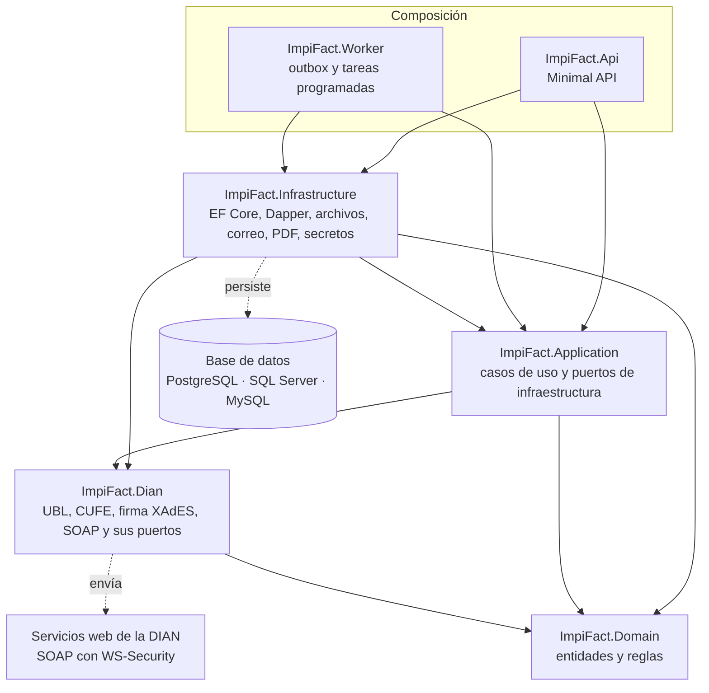
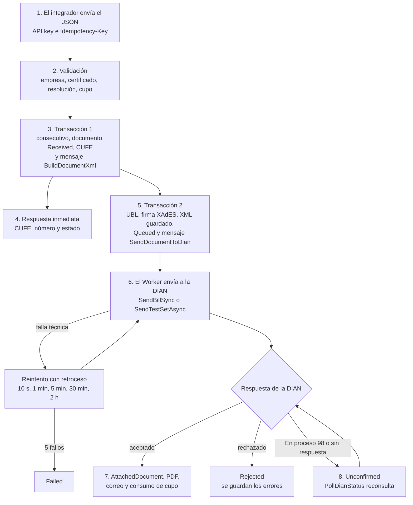
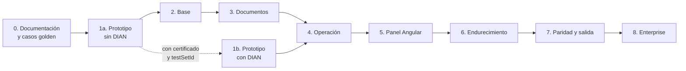

# PRD y Arquitectura — ImpiFact: migración de ApiDian a .NET 10 + Angular

Nov 13, 2026 · @Santiago

## 1. Resumen ejecutivo

Se reescribirá la edición Community de [ApiDian](https://github.com/facturalatam/apidian) (PHP 8.1 + Laravel 10; el archivo `LICENSE` dice MIT, pero `composer.json` declara LGPL-3.0: ver sección 13) en .NET 10 y Angular, como monolito modular con Clean Architecture. Después de la paridad con Community se construirán las funciones Enterprise.

No se escribe código hasta que este PRD, la arquitectura y el modelo de datos estén aprobados.

**Cómo leer las referencias.** «ADR-NN» es un *registro de decisión de arquitectura* (Architecture Decision Record): una decisión técnica numerada, con lo que se decidió y por qué. Cuando el texto dice «(ADR-22)», esa es la decisión que lo respalda. El índice de todos los ADR está en la sección 13.

### Glosario

| Término | Qué significa |
| --- | --- |
| ADR | *Architecture Decision Record*: decisión técnica numerada con su resolución y su porqué. El índice está en la sección 13. |
| AIU | Factura con Administración, Imprevistos y Utilidad, típica de contratos de obra. Fase 7. |
| API key | Clave que identifica a un integrador ante el API. Se guarda solo su hash. |
| AttachedDocument | XML contenedor que se envía al comprador con la factura y la respuesta de validación de la DIAN. |
| Clave técnica | Valor que la DIAN entrega con la resolución de numeración; entra en el cálculo del CUFE. |
| Código 98 «En proceso» | Respuesta de la DIAN cuando aún no decide; el documento queda `Unconfirmed` y se reconsulta. |
| Community / Enterprise | Las dos ediciones de ApiDian. Community es la base de la paridad (fases 0 a 7); Enterprise llega en la fase 8. |
| Contingencia | Emisión cuando la DIAN o los sistemas propios no están disponibles; se transmite después. Fase 7. |
| Contract test | Prueba que ejecuta la colección Postman oficial contra .NET y compara las respuestas con el contrato. |
| CUDE | Código Único de Documento Electrónico: el equivalente del CUFE para notas, documento soporte y eventos. |
| CUFE | Código Único de Factura Electrónica: hash que identifica cada factura ante la DIAN; se calcula con sus datos y la clave técnica. |
| CUNE | Equivalente del CUFE para la nómina electrónica (Enterprise). |
| Data Protection | Mecanismo de ASP.NET Core para cifrar secretos (PIN, SMTP, tokens) con llaves que rotan. |
| Documento soporte | Documento que respalda compras a proveedores no obligados a facturar. Fase 7. |
| Golden test | Prueba que compara el XML y el CUFE de .NET con los que generó el PHP para la misma entrada. Es la prueba principal de la paridad. |
| Habilitación / producción | Ambientes de la DIAN: en habilitación se prueba el software con el set de pruebas; en producción los documentos tienen validez fiscal. |
| Idempotency-Key | Encabezado que permite reintentar una petición sin crear un documento duplicado. |
| Mandato | Factura que se emite a nombre de un tercero (el mandante). Fase 7. |
| Minimal API | Estilo de ASP.NET Core para declarar endpoints sin controladores (ADR-11). |
| Multi-tenant | Una sola instalación sirve a varias empresas (*tenants*) con sus datos aislados. |
| OpenAPI / Scalar | OpenAPI describe el API en un archivo estándar; Scalar es la página interactiva que lo muestra (reemplaza a Swagger). |
| Outbox | Tabla de mensajes que se escriben en la misma transacción que el cambio de datos; el Worker los procesa con reintentos (ADR-03 y ADR-22). |
| Paridad | Que .NET haga lo mismo que el PHP Community, con el mismo XML y CUFE. |
| Puerto | Interfaz que define lo que el núcleo necesita (guardar, enviar, firmar); otra capa la implementa (Clean Architecture). |
| Proveedor tecnológico | Figura de la DIAN para quien emite documentos a nombre de terceros; aplica si se revende la plataforma (revisión crítica #1). |
| RADIAN | Registro de la DIAN para la factura como título valor; sus eventos son acuse de recibo, recibo del bien, aceptación y reclamo. Fase 7. |
| Regla 90 | Rechazo de la DIAN porque el documento ya existe; se trata como reconciliación, no como error. |
| Resolución de numeración | Autorización de la DIAN con prefijo, rango de números, vigencia y clave técnica. |
| SOAP / WS-Security | Protocolo de los servicios web de la DIAN y su esquema de firma de los mensajes. |
| Spike | Prueba corta y desechable para decidir entre opciones técnicas antes de comprometerse. |
| testSetId | Identificador del set de pruebas que la DIAN asigna en habilitación. |
| trackId | Identificador que devuelve la DIAN al recibir un documento; sirve para consultar su estado. |
| UBL 2.1 | Estándar XML (OASIS) que la DIAN usa para los documentos electrónicos. |
| Worker | Proceso aparte que ejecuta el trabajo asíncrono: generar XML, enviar a la DIAN, reconsultar y enviar correos. |
| XAdES | Estándar de firma digital de XML; la DIAN exige el perfil XAdES-EPES con el certificado de la empresa. |

| Dato | Valor |
| --- | --- |
| Sistema origen | ApiDian Community (Laravel 10, MySQL/MariaDB) |
| Tamaño origen | \~46.400 líneas PHP (`app`, `routes`, `database`, `config`), 53 controladores, 56 modelos, 123 rutas API, 134 migraciones |
| Destino | .NET 10, ASP.NET Core, EF Core + Dapper, Angular |
| Bases de datos | PostgreSQL (principal), SQL Server, MySQL |
| Nubes objetivo | Azure, AWS, GCP |
| Fases 0 a 7 | Paridad funcional con Community (sección 12) |
| Fase 8 | Enterprise: nómina, POS, RIPS, roles avanzados, extractor de compras, app móvil |

La firma XAdES y el SOAP con la DIAN dependen de la librería externa `ubl21dian/torresoftware`, que no está en el repo y debe portarse. Es el mayor riesgo técnico (sección 13).

**Versiones del origen.** El código analizado es el repositorio público Community (Laravel 10, PHP ^8.1, 134 migraciones). El [manual](https://manual.facturalatam.com/) documenta una edición más reciente: Laravel 10.49.1 pasa a 13, PHP mínimo 8.3 y 205 migraciones, con tablas que parecen de nómina ([actualización 2027](https://manual.facturalatam.com/apidian/actualizacion-2027/)). Decidido el 13-nov-2026: la fuente de paridad es el repositorio Community (ver «Decisiones confirmadas»).

**Por qué migrar ahora.** En octubre de 2026 se publicaron dos vulnerabilidades críticas de PHP (CVSS 9.2, ejecución remota sin autenticación) y PHP 8.1 ya no recibe versiones ([aviso de seguridad](https://manual.facturalatam.com/apidian/aviso-seguridad-php/)). El repo Community exige justamente PHP 8.1 o superior.

## 2. Objetivos, no-objetivos y métricas

La migración se considera exitosa cuando .NET emite los mismos documentos que el PHP, con el mismo XML y CUFE, y la DIAN los acepta en habilitación y producción.

**Objetivos**

- Paridad funcional con Community: factura, notas, documento soporte, exportación, contingencia, eventos RADIAN, catálogos, resoluciones y paso a producción.
- Arquitectura limpia y mantenible, lista para agregar módulos Enterprise sin tocar el núcleo.
- Portabilidad: PostgreSQL, SQL Server o MySQL, desplegable en Azure, AWS o GCP.
- Mejor seguridad que el original: certificados cifrados, secretos fuera del disco, aislamiento por empresa.
- Panel Angular que reemplace al panel Blade/Laravel.

**No-objetivos (fase 1)**

- Nuevas funciones Enterprise (nómina, POS, RIPS, extractor, app móvil).
- Cambiar el contrato del API: se mantiene compatible con las rutas actuales.
- Microservicios.
- Migrar datos de producción de instalaciones existentes (resuelto: sin migración de datos, ADR-07).

**Métricas de éxito**

| Métrica | Meta |
| --- | --- |
| XML y CUFE idénticos al PHP (pruebas golden) | 100% de los casos de prueba |
| Documentos aceptados por la DIAN en habilitación | 100% de los tipos soportados |
| Colección Postman oficial en verde contra .NET | 100% de las rutas migradas |
| Cobertura de pruebas en Domain y Application | ≥ 80% |
| Mismo despliegue en Azure, AWS y GCP | Docker + variables de entorno, sin cambios de código |

## 3. Usuarios, roles y casos de uso

El sistema original tiene cuatro tipos de usuario, y cada uno tiene su propio inicio de sesión en las rutas web. La migración los conserva.

| Rol | Quién es | Qué hace |
| --- | --- | --- |
| Propietario / Administrador | Dueño de la instalación o revendedor | Crea empresas, asigna planes, consulta resúmenes y administra usuarios |
| Empresa emisora (Seller) | La empresa que factura | Configura software, certificado y resoluciones; consulta documentos y eventos; recibe documentos |
| Cliente (Customer) | Adquirente de la factura | Descarga sus documentos y acepta o rechaza facturas (RADIAN) |
| Integrador (API) | ERP o aplicación externa | Envía documentos por API con Bearer token |

**Casos de uso principales**

1. Crear una empresa y configurarla: software, certificado digital, resoluciones, ambiente (habilitación o producción) y logo.
2. Emitir un documento: el integrador envía un JSON y recibe CUFE, XML y PDF.
3. Consultar el estado de un documento o de un lote ante la DIAN.
4. Emitir notas crédito y débito sobre un documento existente.
5. Enviar eventos RADIAN: acuse, recibo, aceptación o rechazo.
6. Regenerar el PDF, reenviar el correo y descargar archivos.
7. Pasar una empresa de habilitación a producción.
8. Consultar el resumen de documentos por rango de fechas.

## 4. Requisitos funcionales (paridad con Community)

Cada fila corresponde a un grupo de rutas del API original. P0 = obligatorio para emitir; P1 = necesario para operar; P2 = complementario.

| ID | Módulo | Requisito | Origen (PHP) | Prioridad |
| --- | --- | --- | --- | --- |
| RF-01 | Configuración | Crear y eliminar empresas por NIT; configurar software, certificado, resolución, ambiente, logo y correo | `ConfigurationController` (1.448 líneas) | P0 |
| RF-02 | Factura de venta | Factura nacional, con vista preliminar, prueba en habilitación (`testSetId`) y consecutivo actual | `InvoiceController` | P0 |
| RF-03 | Factura de exportación | Factura de exportación con Incoterms y moneda extranjera | `InvoiceExportController` | P0 |
| RF-04 | Factura de contingencia | Contingencia tipos 3 y 4 y envío de pendientes | `InvoiceContingencyController` | P0 |
| RF-05 | Otras facturas | AIU, mandato y transporte | `InvoiceAIU`, `InvoiceMandate`, `InvoiceTransport` | P1 |
| RF-06 | Notas | Nota crédito y nota débito | `CreditNoteController`, `DebitNoteController` | P0 |
| RF-07 | Documento soporte | Documento soporte y su nota de ajuste | `SupportDocumentController`, `sdCreditNoteController` | P0 |
| RF-08 | Firma y envío | Firmar XML, enviar a la DIAN (sync y async) y consultar estado por `trackId` o ZIP | `SignDocument`, `SendDocument`, `StatusDocument`, `StatusZip`, `StateController` | P0 |
| RF-09 | Lotes | Agregar documentos a un lote y enviarlo | `BatchController` | P1 |
| RF-10 | Eventos RADIAN | Enviar y consultar eventos, procesar recepción del vendedor, cargar documento por CUFE | `SendEventController`, `RadianEventController` | P1 |
| RF-11 | Rango de numeración | Consultar rangos de numeración en la DIAN | `NumberingRangeController` | P1 |
| RF-12 | PDF y correo | Generar y regenerar PDF, enviar correo, unir PDFs, plantillas | `RegeneratePDF`, `SendEmail`, `Download`, `Miscelaneous` | P0 |
| RF-13 | Catálogos | Municipios, medios y formas de pago, tipos de documento, monedas y TRM, ítems, clientes | `Municipality`, `Payment`, `Trm`, `Item`, `Customer` | P1 |
| RF-14 | Planes y administradores | Planes por empresa, administradores y consulta de usuarios por plan | `ConfigurationController` | P2 |
| RF-15 | Paso a producción | Asistente de habilitación: software, resoluciones, documentos de prueba, ambiente | `ProductionController` (1.098 líneas) | P0 |
| RF-16 | Panel web | Portales de propietario, vendedor y cliente; listados, impuestos, configuraciones, acepta o rechaza documento | Rutas `web.php` (164 líneas) | P1 |
| RF-17 | Almacenamiento | Guardar XML, PDF y adjuntos en disco o S3, con descarga pública por token | `StorageService`, `DownloadController` | P1 |
| RF-18 | WhatsApp | Configuración y envío de mensajes con PDF | `WhatsappConfigController` | Enterprise (fase 8) |
| RF-19 | Respaldos | Respaldo diario programado | `spatie/laravel-backup` | P2 |

**Primera entrega (decidido el 14-nov).** Las fases 3 y 4 cubren factura nacional, notas crédito y débito, resoluciones, certificado, ambiente y consultas, más lo necesario para operarlas (firma y envío, PDF y correo, catálogos, planes, almacenamiento y paso a producción). RF-03, RF-04, RF-05, RF-07, RF-09 y RF-10 pasan a la fase 7. RF-18 (WhatsApp) es Enterprise.

Hay rutas del API original que cubren un mismo flujo con variantes, por ejemplo `testSetId` para habilitación y cada tipo de factura. En .NET se unifican en un solo caso de uso por tipo de documento.

**Novedades del manual que el repo Community puede no tener.** Hay que confirmar cuáles existen en la edición fuente antes de comprometerlas ([novedades](https://manual.facturalatam.com/apidian/novedades/)).

- `POST /api/ubl2.1/resend-document`: reenvía a la DIAN un documento ya firmado sin generar otro.
- `GET /api/ubl2.1/config/query/{nit}`, `PUT /config/smtp` y `PUT /config/smtp-global`: consulta de configuración y correo por empresa y general.
- Regeneración del AttachedDocument de un documento emitido.
- `type_environment_id` opcional al consultar el próximo consecutivo (`current_number`).
- Comandos de consola `setup:token`, `setup:reset`, `setup:admin` y `expirations:notify`. En .NET pasan a un asistente de instalación inicial y a una tarea del Worker que avisa del vencimiento de certificados.
- Monitoreo de peticiones lentas (`monitoring_slow_requests`): en .NET lo cubre OpenTelemetry.
- Almacenamiento `local` y `s3` ([manual S3](https://manual.facturalatam.com/apidian/almacenamiento-s3/)), más un modo `dual` que menciona la guía de rendimiento.
- El manual lista también nómina, API RIPS, Extractor V2, WhatsApp, servicios para la app y asistente de IA: son la base del alcance Enterprise (fase 8).

## 5. Requisitos no funcionales

Las metas numéricas son propuestas iniciales y quedan para validar en la sección 13.

| ID | Categoría | Requisito | Meta propuesta |
| --- | --- | --- | --- |
| RNF-01 | Portabilidad de BD | PostgreSQL, SQL Server y MySQL con un solo `DbContext` y migraciones por proveedor | PostgreSQL desde la fase 2; SQL Server y MySQL en la fase 6 |
| RNF-02 | Portabilidad de nube | Docker, configuración por variables de entorno, almacenamiento abstraído (`IBlobStorage`) | Azure, AWS y GCP sin cambios de código |
| RNF-03 | Seguridad | Certificados cifrados, secretos en Key Vault, Secrets Manager o Secret Manager; API keys con hash | Ningún secreto en disco ni en logs |
| RNF-04 | Aislamiento | Datos separados por empresa con filtro global de EF y pruebas que lo verifican | 0 fugas entre empresas en pruebas |
| RNF-05 | Rendimiento | La API responde sin esperar a la DIAN; el Worker procesa en segundo plano | Respuesta de la API < 500 ms al aceptar un documento (p95) |
| RNF-06 | Resiliencia | Reintentos con retroceso exponencial y circuit breaker hacia la DIAN | Sin pérdida de documentos si la DIAN está caída |
| RNF-07 | Idempotencia | Reenviar el mismo documento no genera duplicados | Misma respuesta ante el mismo prefijo y número |
| RNF-08 | Observabilidad | Logs estructurados (Serilog), trazas y métricas (OpenTelemetry), health checks | Correlation id en cada solicitud |
| RNF-09 | Auditoría | Registro de quién cambió certificados, resoluciones y configuración | Toda operación sensible queda registrada |
| RNF-10 | Mantenibilidad | Clean Architecture, reglas de dependencia verificadas con pruebas de arquitectura | Domain sin referencias externas |
| RNF-11 | Calidad | Pruebas unitarias, de integración con Testcontainers y golden tests contra el PHP | Cobertura ≥ 80% en Domain y Application |
| RNF-12 | Compatibilidad | Mismas rutas y formato JSON del API actual en `/api/ubl2.1/...` | Colección Postman oficial en verde |

Referencias del PHP actual ([rendimiento](https://manual.facturalatam.com/apidian/rendimiento/)): el grupo `api` admite 60 peticiones por minuto, el correo se envía dentro de la petición, la subida a S3 también, y no hay colas ni envío asíncrono. De ahí salen el diseño asíncrono (RNF-05) y el límite de tasa configurable por API key.

## 6. Arquitectura

*Seis proyectos y dos sistemas externos. Las flechas continuas son referencias entre proyectos; las punteadas, llamadas a sistemas externos.*

`Application` define los puertos de infraestructura (base de datos, archivos, correo, secretos) e `Infrastructure` los implementa. Los puertos de la DIAN se definen e implementan en `Dian` (ADR-23). Así se cambia de nube o de base de datos sin tocar el dominio.

**Reglas de dependencia**

- `Domain` no referencia a nadie.
- `Dian` referencia solo a `Domain`. Es puro (UBL, CUFE, firma, SOAP) y define e implementa sus propios puertos (ADR-23).
- `Application` referencia a `Domain` y a `Dian`.
- `Infrastructure` referencia a `Application`, `Dian` y `Domain`.
- `Api` y `Worker` referencian a `Application` e `Infrastructure`, y solo hacen la composición.
- Hay un proyecto de migraciones por proveedor de base de datos (`Infrastructure.Postgres`, `.SqlServer`, `.MySql`).
- Una prueba de arquitectura falla el build si se rompe cualquiera de estas reglas.

**Módulos dentro de las capas** (una carpeta por módulo en cada proyecto)

| Módulo | Contenido |
| --- | --- |
| Empresas | Empresa, software, certificado, resoluciones, ambientes, planes |
| Documentos | Facturas, notas, documento soporte, líneas, impuestos, envíos, archivos |
| Eventos | Eventos RADIAN y documentos recibidos |
| Catálogos | Tablas DIAN, municipios, impuestos, monedas, TRM |
| Acceso | Usuarios, roles, API keys, auditoría |
| Plataforma | Administradores, planes, cupos, respaldos |

## 7. Flujo de emisión de documentos

*Detalle paso a paso en «Arquitectura detallada» sección 7.*

El integrador recibe el identificador del documento de inmediato y consulta el estado hasta que la DIAN responde. Los *webhooks* no están en la v1 (ADR-22). Para mantener compatibilidad, la ruta heredada puede esperar el resultado hasta un tiempo máximo, como hace el PHP (ADR-02 y ADR-13).

**Estados del documento**

Resumen. Los valores, las transiciones y el diagrama están en «Modelo de datos detallado» sección 4, que manda.

| Estado | Significado |
| --- | --- |
| `Received` | Solicitud validada y guardada; todavía no hay XML |
| `Queued` | XML UBL firmado y mensaje de envío en el outbox |
| `Sent` | La DIAN recibió el documento; se espera su respuesta (`trackId`) |
| `Accepted` / `AcceptedWithWarnings` | La DIAN lo validó; se generan PDF, archivos y correo |
| `Rejected` | La DIAN lo rechazó; se guardan los errores y no se reintenta |
| `Unconfirmed` | Respuesta «En proceso» (98) o sin respuesta; se reconsulta |
| `Failed` | Error técnico tras agotar los reintentos con retroceso |
| `ContingencyPending` | Emitido en contingencia; falta transmitirlo |
| `Draft` | Vista previa en memoria; nunca se persiste |

**Estado adicional: En proceso (código 98).** Desde septiembre de 2026 la DIAN puede responder "En proceso". El documento pasa a `Unconfirmed`, conserva su número reservado y se vuelve a consultar hasta que la DIAN decida ([novedades](https://manual.facturalatam.com/apidian/novedades/)). Los catálogos de la DIAN aceptan fechas solo en formato `YYYY-MM-DD`.

**Reglas del flujo**

- El consecutivo se toma en una transacción corta, antes de generar el XML, con un solo `UPDATE` atómico por motor, para que dos solicitudes no tomen el mismo número (ADR-24 y «Modelo de datos detallado» sección 5).
- Reenviar el mismo prefijo y número devuelve el documento existente, no crea otro.
- El XML, el PDF y cada intento de envío quedan guardados para auditoría.
- Los eventos RADIAN, las notas y el documento soporte siguen el mismo camino con su propia plantilla UBL.

## 8. Modelo de datos

El esquema original tiene 134 migraciones y unos 40 catálogos y tablas de negocio. El .NET parte de un esquema limpio, no de una copia de las migraciones, y conserva los códigos de la DIAN en los catálogos.

**Especificación completa por tabla, columnas, índices, diferencias entre motores y criterios de aceptación:** Modelo de datos detallado. Esta sección es el resumen; ante cualquier diferencia manda esa pestaña.

**Problemas detectados en el esquema PHP**

- `documents` es una tabla plana de \~77 columnas que guarda el XML, el PDF, la solicitud y la respuesta de la DIAN como texto.
- `documents` se enlaza a la empresa por `identification_number` (el NIT) y no por clave foránea. Lo mismo ocurre con el cliente.
- La empresa lleva hasta cuatro planes (`type_plan_id` a `type_plan4_id`) con cuatro fechas de inicio en columnas repetidas.
- Hay credenciales de correo (`mail_password`) y `api_token` dentro de la tabla `users`, y contraseñas dentro de `companies` y `customers`. Confirmado en el código: todo en texto plano, y el `api_token` es `sha256(NIT)` («php-rules», sección 6).
- Varias migraciones corrigen datos de catálogos (por ejemplo `codefacturador` de municipios), lo que indica catálogos que cambian con el tiempo.

**Entidades del nuevo modelo**

| Grupo | Entidad | Origen PHP | Cambio propuesto |
| --- | --- | --- | --- |
| Tenant | `Company` | `companies` | Clave propia (GUID), NIT y DV únicos, ambientes por tipo de documento en una tabla hija |
| Tenant | `CompanyEnvironment` | 5 columnas `*_type_environment_id` | Una fila por tipo de documento con su ambiente actual |
| Tenant | `CompanyPlan` | 4 columnas de plan y fechas | Una fila por plan activo, con vigencia |
| Tenant | `Software` | `software` | Una fila por tipo de documento y ambiente (factura, nómina, equivalente, soporte, eventos) |
| Tenant | `Certificate` | `certificates` | Archivo cifrado en Key Vault; en BD solo referencia, vencimiento y huella |
| Tenant | `Resolution` | `resolutions` | Igual, con `CompanyId`, rango y vigencia validados |
| Tenant | `Customer`, `Item` | `customers`, `items` | Se enlazan por `CompanyId` |
| Acceso | `AppUser`, `UserCompany` | `users`, `company_user` | Identity de ASP.NET; sin credenciales de correo en el usuario |
| Acceso | `ApiKey` | `users.api_token` | Hash, prefijo visible, alcance y vencimiento |
| Acceso | `CompanyMailSettings` | campos `mail_*` en `users` | Tabla propia, contraseña cifrada |
| Documentos | `Document` | `documents` (77 columnas) | Cabecera con estado, totales, CUFE y referencias |
| Documentos | `DocumentLine`, `DocumentTax` | JSON dentro de `documents` | Tablas hijas para líneas e impuestos |
| Documentos | `DianSubmission` | `request_api`, `response_dian` | Un registro por intento de envío: solicitud, respuesta, `trackId`, estado |
| Documentos | `DocumentFile` | `xml`, `pdf` | XML y PDF en almacenamiento de objetos; en BD solo la referencia |
| Documentos | `DocumentEvent` | `received_documents`, `events` | Eventos RADIAN con su CUDE y carga útil |
| Documentos | `ReceivedDocument` | `received_documents` | Igual, enlazado a la empresa por `CompanyId` |
| Operación | `NumberingSequence` | `sends` | Consecutivo por resolución (o por tipo, ambiente, prefijo y año si no hay resolución), tomado con un `UPDATE` atómico |
| Operación | `OutboxMessage` | no existe | Cola de trabajos del Worker (XML, envío a la DIAN, correo) con reintentos |
| Operación | `AuditLog` | `logs` | Quién, qué, cuándo y desde dónde |
| Operación | `DataProtectionKey` | no existe | Llaves de Data Protection compartidas entre instancias (ADR-25) |
| Plataforma | `Reseller`, `Plan` | `administrators`, `plans` | Revendedor y plan con cupos por tipo de documento |
| Plataforma | Catálogos DIAN | \~25 tablas `type_*`, `taxes`, `countries`, `municipalities`, etc. | Se cargan con seeders versionados, no con `LOAD DATA` |

**Reglas para soportar tres motores**

- Un `DbContext` y un proyecto de migraciones por proveedor (`Infrastructure.Postgres`, `.SqlServer`, `.MySql`).
- Claves GUID (v7) generadas en la aplicación, no por la base.
- Fechas en UTC y `DateTimeOffset`.
- JSON como `jsonb` en Postgres, `nvarchar(max)` con validación en SQL Server y `json` en MySQL, mapeado con un convertidor único.
- NIT, prefijo, correo y CUFE se guardan normalizados y se comparan sin depender de la collation del motor.
- Índice único `(company_id, document_type_id, type_environment_id, prefix, number)` para evitar duplicados.
- Dapper solo para lecturas; el SQL que no sea estándar vive en una clase por proveedor.
- Los catálogos se cargan con seeders de EF en lotes; no se usa `LOAD DATA` ni `BULK INSERT`.

## 9. Diseño de API

La v1 de .NET conserva las rutas y el JSON del API actual bajo `/api/ubl2.1/`. Así la colección Postman oficial sirve como regresión y los integradores no cambian nada. La v2 (rutas limpias, REST estricto) se diseña después de terminar la migración.

**Inventario de rutas del origen** (`routes/api.php`, 439 líneas; el panel web tiene otras 164)

| Grupo | Rutas representativas | Auth en PHP |
| --- | --- | --- |
| Configuración | `config/{nit}/{dv?}`, `config/software`, `certificate`, `resolution`, `environment`, `logo`, `resolutions/{nit}/{tipo}` | `check.api.register` para crear y eliminar; `auth:api` para el resto |
| Facturas | `invoice`, `invoice/{testSetId}`, `invoice/current_number/...`, `preeliminar-view`, `state_document/...` | `auth:api` |
| Variantes de factura | `invoice-export`, `invoice-contingency`, `invoice-contingency-4/send_pendings`, `invoice-aiu`, `invoice-mandate`, `invoice-transport` | `auth:api` |
| Notas | `credit-note`, `debit-note`, `sd-credit-note` (con y sin `testSetId`) | `auth:api` |
| Documento soporte | `support-document` y `support-document/{testSetId}` | `auth:api` |
| Lotes | `invoice/{batch}`, `credit-note/{batch}`, `send-batch/{batch}`, entre otros | `auth:api` |
| Firma y envío directo | `signdocument`, `senddocument`, `statusdocument`, `statuszip` | **Sin autenticación** |
| Estado | `status/zip/{trackId}`, `status/document/{trackId}`, `events-document/{trackId}` | `auth:api` |
| Eventos RADIAN | `send-event`, consulta por prefijo, número, UUID y CUFE; `process-seller-document-reception`; `load-document-by-cufe` | `auth:api` |
| PDF y correo | `regeneratepdf`, `send-email`, `send-email-customer`, `join-pdfs`, `reload-pdf`, `templates` | `auth:api` |
| Catálogos y utilidades | `table/*`, `municipality-codes-by-facturador`, `payment-methods`, `items`, `currencies`, `trm`, `customer/{doc}/{nit}`, `name-by-nit/{nit}` | mixta |
| Descargas | `download/{id}/{file}`, `invoice/xml/{file}`, `invoice/pdf/{file}` | URL pública |
| Planes y admin | `plan`, `plan/query`, `administrator`, `listing` | mixta |
| Resumen | `information/{nit}/{desde}/{hasta}` | `auth:api` |

**Decisiones**

- Los controladores se reemplazan por endpoints *Minimal API* delgados (ADR-11) que llaman a un caso de uso (`IHandler<TIn, TOut>`). Un handler por tipo de documento, no uno por ruta.
- Las variantes con `testSetId` se resuelven con el mismo handler y el ambiente de la empresa, sin duplicar código.
- Versionado por ruta: `/api/v1/...` es la ruta canónica que usa el panel. Las rutas heredadas (`/api/ubl2.1/...` y demás) se publican como alias para los contract tests.
- OpenAPI nativo de .NET 10 y Scalar como documentación, como en tu proyecto de referencia.
- Autenticación: API key con hash por empresa para integradores y JWT con refresh para el panel Angular.
- `signdocument`, `senddocument`, `statusdocument` y `statuszip` estaban abiertas en el repo analizado, y el PHP de octubre de 2026 ya las protege. En .NET exigen API key (ADR-06); no hay clientes legados que dependan de ellas.
- Las descargas públicas usan URLs firmadas con vencimiento, no rutas adivinables.
- Respuesta estándar de error (RFC 9457, `ProblemDetails`) manteniendo además los campos `success` y `message` del API original.
- Limitación de tasa por API key y por IP.

Las rutas `information/{nit}` (resumen por empresa) también están fuera del grupo autenticado en el PHP. Se tratan igual que las anteriores: en .NET requieren API key.

**Contrato oficial: colección Postman [FacturaLatam ApiDianV2.1](https://documenter.getpostman.com/view/50442293/2sBYHUSfRJ)** (185 requests en 14 carpetas). Es el contrato contra el que se prueba .NET. La columna de edición sigue el README de GitHub: nómina, documento equivalente, RIPS, extractor y app son Enterprise.

| Carpeta | Requests | Endpoints principales | Edición |
| --- | --- | --- | --- |
| 01 Configuraciones básicas | 21 | `config/{nit}`, `config/certificate`, `config/resolution`, `config/software`, `softwarepayroll`, `softwaresupportdocument`, `softwareeqdocs` | Community; nómina y equivalentes Enterprise |
| 02 Primeros envíos | 47 | `invoice`, `invoice/preeliminar-view`, `credit-note`, `debit-note`, `support-document`, `sd-credit-note`, `invoice-contingency-4`, `payroll`, `payroll-adjust-note`, `eqdoc` | Community; `payroll` y `eqdoc` Enterprise |
| 03 Consultas de estado | 5 | `status/zip`, `status/document`, `status/events-document` | Community |
| 04 Casuísticas de envíos | 19 | Variantes de `invoice` y `credit-note`, incluida `/public/api/ubl2.1/invoice` | Community |
| 05 Utilidades | 26 | `information`, `total_documents`, `next-consecutive`, `current_number`, `xml/document`, `download`, `send-email`, `send-email-customer`, `send-email-employee`, `join-pdfs`, `config/logo`, `certificates-listing`, `certificate-end-date`, `regenerate-attached-document`, `delete/company` | Community; `send-email-employee` Enterprise |
| 06 Paso a producción | 2 | `config/environment`, `numbering-range` | Community |
| 07 Otros tipos de facturas | 16 | `invoice-mandate`, `invoice-aiu`, `invoice-contingency`, `invoice-export`, `invoice-transport` | Community |
| 08 Generador de eventos | 3 | `send-event`, `send-event-data`, `load-document-by-cufe` | Community |
| 09 Planes | 7 | `plan`, `plan/query`, `plan/infoplanuser`, `plan/queryusersbyplan` | Community |
| 10 Regenerar PDFs | 4 | `regeneratepdf`, `templates` | Community |
| 11 Servicios APP | 11 | `login`, `documents`, `customers`, `items`, `table/*`, `download` | Enterprise (app móvil) |
| 12 API RIPS | 16 | `auth/LoginSISPRO`, `PaquetesFevRips/Cargar*`, `ConsultasFevRips/*` | Enterprise; servicio aparte |
| 13 WhatsApp | 4 | `whatsapp-config`, `send-message` | Enterprise (decidido el 14-nov) |
| 14 Extractor V2 | 4 | `extractor/company/stream`, `extractor/company/jobs/{job_id}`, `certificate` | Enterprise |

**Hallazgos de la colección**

- La autenticación es Bearer con variables `url_base` y `token`. El servicio de RIPS usa otra URL (`url_apirips`) y otro token, así que es un servicio separado y no parte del Laravel.
- El JSON mínimo de una factura tiene 11 claves: `number`, `type_document_id`, `date`, `time`, `resolution_number`, `prefix`, `customer`, `payment_form`, `legal_monetary_totals`, `tax_totals` e `invoice_lines`. El cliente mínimo lleva solo `identification_number` y `name`. Es la base de los DTO y de los casos golden.
- Cada línea lleva `unit_measure_id`, `invoiced_quantity`, `line_extension_amount`, `free_of_charge_indicator`, `description`, `code`, `type_item_identification_id`, `price_amount`, `base_quantity` y sus `tax_totals`.
- Hay rutas fuera de `/ubl2.1/` (`/information`, `/total_documents`, `/documents`, `/customer`, `/templates`, `/login`, `/table/*`, `/items`, `/whatsapp-config`, `/extractor/*`, `/send-email-customer`) y descargas por NIT y archivo. La v1 de .NET las conserva.
- Varias rutas no estaban en el repo Community analizado, por ejemplo `send-email-employee`, `regenerate-attached-document`, `total_documents`, `payroll`, `payroll-adjust-note` y `eqdoc`.
- La colección pública incluye valores de ejemplo con aspecto de credenciales reales. Las pruebas de contrato usan tokens propios, nunca esos valores.

## 10. Seguridad

El PHP resuelve lo básico (contraseñas con `bcrypt`) pero deja los secretos más sensibles al alcance de quien lea la base o el disco. La migración corrige eso desde el diseño.

**Hallazgos en el código origen**

| Hallazgo | Evidencia | Riesgo |
| --- | --- | --- |
| El certificado `.pfx` se guarda como archivo en `storage/certificates/` | `ConfigurationController` líneas 531 y 661 (`StorageService::putLocal`) | Quien acceda al disco obtiene el certificado de firma |
| La clave del `.pfx` se lee de la tabla `certificates` y se pasa directo a `openssl_pkcs12_read` | `ConfigurationController` línea 533 | No se ve cifrado en el código leído; hay que confirmarlo en el modelo |
| `api_token` vive en `users` y se usa tal cual | `User.php`, `HomeController` línea 86, `ProductionController` línea 108 | Una fuga de la BD entrega todos los tokens |
| Credenciales SMTP (`mail_password`) en `users` | Migración `add_email_server_fields_to_users` | Contraseñas de correo expuestas |
| Cuatro rutas de firma y envío sin autenticación (en el repo analizado; el PHP actual ya las cerró) | `routes/api.php` líneas 37 a 55 | Cualquiera podría llamarlas si conoce la ruta |
| Existe un "modernizador" de certificados antiguos | `CertificateModernizerService` | Hay certificados con cifrado heredado que .NET debe poder abrir |

**Lo que dice el manual (octubre de 2026)** ([aviso de rutas](https://manual.facturalatam.com/apidian/aviso-seguridad-rutas/), [novedades](https://manual.facturalatam.com/apidian/novedades/)):

- Las rutas de empresas, correo general, planes y administradores exigen el header `X-Admin-Token`.
- Firma, envío y estado exigen el `api_token` de la empresa, y las rutas con NIT solo responden si el NIT pertenece a la empresa del token.
- Los tokens de empresas creadas antes se calculaban a partir del NIT, así que eran predecibles.
- `/api/download/...` sigue aceptando llamadas sin token y se cerrará en una versión posterior.
- `GET /api/ubl2.1/config/certificate` devuelve el `.p12` de la empresa en base64.

**Decisión para .NET:** se adopta el modelo nuevo desde el inicio. Token de plataforma para administración, API key por empresa generada al azar y guardada con hash, y propiedad por NIT validada en cada ruta. El certificado nunca sale de la bóveda: no se replica el endpoint que lo devuelve.

**Diseño en .NET**

- **Certificados:** el `.pfx` y su clave se guardan en Azure Key Vault, AWS Secrets Manager o GCP Secret Manager, detrás de `ICertificateStore`. En BD solo quedan la referencia, el vencimiento y la huella. Alternativa para instalaciones sin nube: cifrado con una llave maestra (AES-GCM) fuera de la base.
- **API keys:** se muestran una sola vez, se guardan con hash (SHA-256) y llevan prefijo visible, empresa, alcance y vencimiento. Se pueden rotar y revocar.
- **Panel:** JWT de vida corta con refresh y roles (propietario, vendedor, cliente) sobre ASP.NET Identity.
- **Aislamiento:** filtro global por `CompanyId` y una prueba por cada entidad que verifique que ninguna consulta cruza empresas.
- **Transporte:** HTTPS obligatorio, HSTS, CORS con lista explícita.
- **Archivos:** XML y PDF en almacenamiento privado; descargas con URL firmada y vencimiento.
- **Auditoría:** `AuditLog` para cambios de certificados, resoluciones, claves y configuración.
- **Logs:** nunca registran claves, tokens ni el contenido del certificado.
- **Dependencias:** análisis de vulnerabilidades en CI y actualización de paquetes con Dependabot.
- **Rotación:** aviso a la empresa antes del vencimiento del certificado.

## 11. Stack tecnológico y convenciones

El stack parte de lo que ya usaste en [EE.UU-Real-Estate](https://github.com/lordimpi/EE.UU-Real-Estate) y cambia lo que no sirve para tres motores de base de datos o para Clean Architecture.

| Área | Decisión | Nota |
| --- | --- | --- |
| Plataforma | .NET 10, ASP.NET Core, C# | LTS |
| Arquitectura | Monolito modular con Clean Architecture | Sin microservicios en esta etapa |
| Casos de uso | Handlers propios (`IHandler<TIn, TOut>`) con decoradores para validación, transacción y logs | MediatR no se usa |
| Mapeo | Mapster | AutoMapper no se usa |
| Validación | FluentValidation |  |
| Resultados | `Result<T>` propio, sin excepciones para flujos esperados |  |
| Escritura de datos | EF Core 10 con migraciones por proveedor y `UnitOfWork` |  |
| Lectura de datos | Dapper sobre `DbConnection` y la transacción del `DbContext` | Reemplaza el `SqlExecutor` de SQL Server |
| Configuración | `IOptions` con `ValidateOnStart` y `GenericOptionsService<T>` | Configuración por empresa va en BD, no en Options |
| API | Minimal API agrupada por módulo (ADR-11), OpenAPI nativo y Scalar | Versionado por ruta |
| Auth | ASP.NET Identity, JWT y API keys con hash |  |
| Procesos en segundo plano | Worker propio sobre cola de BD (outbox); Hangfire como alternativa | Resuelto en ADR-03 y ADR-22 |
| Resiliencia | `Microsoft.Extensions.Http.Resilience` (Polly) | Reintentos y circuit breaker hacia la DIAN |
| Logs y trazas | Serilog, OpenTelemetry, health checks, correlation id |  |
| PDF | QuestPDF o equivalente con plantillas | Reemplaza DomPDF y mPDF; decisión abierta |
| XML y firma | `System.Xml` y `SignedXml` con extensiones XAdES propias | Núcleo del proyecto `ImpiFact.Dian` |
| Almacenamiento | `IBlobStorage` con Local, Azure Blob, S3 y GCS |  |
| Pruebas | NUnit, Moq, Testcontainers, golden tests contra el PHP | EF InMemory solo para pruebas rápidas, no para validar proveedores |
| Frontend | Angular (componentes standalone, signals), cliente generado desde OpenAPI |  |
| Contenedores y CI | Docker, GitHub Actions |  |

**Convenciones**

- Nombres en inglés en código y en español en documentación y mensajes al usuario.
- Un proyecto por capa y una carpeta por módulo dentro de cada capa.
- `Domain` sin dependencias externas; las reglas de dependencia se verifican con pruebas de arquitectura.
- Toda entrada pasa por un validador; toda salida usa DTOs, nunca entidades.
- Los puertos de infraestructura viven en `Application` y se implementan en `Infrastructure`; los de la DIAN viven y se implementan en `Dian` (ADR-23).
- Fechas siempre en UTC; hora de Colombia solo al generar el XML.
- Dinero con `decimal` y redondeo definido por el anexo técnico de la DIAN.

## 12. Plan de migración y pruebas

Cada fase termina en una puerta de salida medible. No se pasa a la siguiente sin cumplirla. Proyecto personal sin fecha límite: las fases se cierran por su puerta de salida, no por calendario. Única excepción: la 1b depende de las credenciales de la DIAN y corre en paralelo desde que existan. La fase 2 arranca al cerrar la 1a, y la 1b debe estar cerrada antes de terminar la fase 4.

| Fase | Contenido | Puerta de salida |
| --- | --- | --- |
| 0. Documentación | PRD, arquitectura, modelo de datos, ADRs, inventario de reglas del PHP (`docs/php-rules.md`), PHP de referencia en Docker con sus casos golden, licencia y consulta regulatoria | Documentos aprobados y casos golden capturados (o plan B definido) |
| 1a. Prototipo sin DIAN | `ImpiFact.Dian`: XML UBL de una factura, CUFE y firma XAdES con un certificado de prueba propio | XML y CUFE iguales a los casos golden; firma válida con una librería independiente |
| 1b. Prototipo con DIAN | Envío SOAP con WS-Security al ambiente de habilitación, con certificado y `testSetId` reales | La DIAN acepta una factura firmada por .NET |
| 2. Base | Solución, capas, DI, Options, Identity, multi-tenant, EF Core con PostgreSQL, seeders de catálogos, CI | Pruebas de arquitectura y de aislamiento en verde |
| 3. Documentos | Primera entrega: factura nacional, notas crédito y débito, resoluciones y consultas | Golden tests: XML y CUFE idénticos al PHP en factura y notas |
| 4. Operación | Estados, Worker con reintentos, PDF, correo, almacenamiento, planes y consumo | Peticiones Postman de la primera entrega en verde (sección 13, revisión #9) |
| 5. Panel Angular | Propietario, vendedor y cliente; configuración; paso a producción | Un flujo completo de alta de empresa y emisión sin usar el panel PHP |
| 6. Endurecimiento | SQL Server, MySQL, Key Vault, Secrets Manager y Secret Manager, observabilidad, pruebas de carga | Mismo despliegue en Azure, AWS y GCP |
| 7. Paridad y salida | Piloto con una empresa real usando la primera entrega; después, el resto de Community: exportación, contingencia, AIU, mandato, transporte, documento soporte, lotes y eventos RADIAN; cierre de la referencia PHP | Una empresa emite en producción con .NET; golden de cada variante y colección Postman Community completa en verde |
| 8. Enterprise | Nómina, POS, RIPS, extractor de compras, roles avanzados, app móvil | Se planifica en un PRD aparte |

**Estrategia de pruebas**

1. **Golden tests (la más importante).** Se corre el PHP con un conjunto de JSON de entrada, se guarda el XML y el CUFE, y .NET debe producir los mismos. Cubre cada tipo de documento y los casos límite: descuentos, impuestos, retenciones, moneda extranjera y redondeo.
2. **Habilitación de la DIAN.** Pruebas con el `testSetId` real para cada tipo de documento.
3. **Contrato.** La colección Postman oficial se ejecuta contra .NET en cada fase.
4. **Unitarias.** Dominio y casos de uso con NUnit y Moq.
5. **Integración.** Testcontainers con PostgreSQL, SQL Server y MySQL en CI.
6. **Arquitectura.** Pruebas que fallan si una capa depende de otra que no debe.
7. **Seguridad.** Pruebas de aislamiento entre empresas y análisis de dependencias.

**Estrategia de salida:** no hay clientes ni datos que migrar. El PHP solo se usa como referencia para generar casos golden y comparar comportamiento, y se deja de usar cuando se cumple la paridad.

## 13. Riesgos, decisiones abiertas y preguntas

**Riesgos**

| Riesgo | Impacto | Mitigación |
| --- | --- | --- |
| Firma XAdES y SOAP con WS-Security difieren entre PHP y .NET | Alto: sin esto no se emite nada | Fase 1 es un prototipo aislado; se valida contra la DIAN antes de seguir |
| La librería `ubl21dian/torresoftware` (`dev-master`) no está en el repo y puede cambiar o desaparecer | Alto | Obtener y fijar una copia del código; documentar su comportamiento con pruebas golden |
| La DIAN cambia anexos técnicos | Medio | Plantillas UBL y reglas versionadas; catálogos con seeders |
| Certificados con cifrado antiguo (el PHP los "moderniza") | Medio | El PHP manda el certificado y su contraseña a un servicio externo para convertirlo; ImpiFact convierte en local y prueba con certificados reales |
| Diferencias de redondeo y decimales entre PHP y .NET | Alto: cambia el CUFE | Golden tests con casos límite; `decimal` y reglas del anexo |
| Tres motores de BD triplican las pruebas | Medio | PostgreSQL primero; SQL Server y MySQL en la fase 6 |
| Soporte de MySQL en EF Core para .NET 10 | Medio | Verificar el proveedor antes de comprometer MySQL |
| Lógica de negocio escondida en controladores de más de 1.400 líneas | Alto | Fase 0: inventario de reglas antes de diseñar casos de uso |
| Clientes que dependen de rutas públicas o de comportamientos no documentados | Medio | Compatibilidad de rutas y colección Postman como contrato |
| Sin pruebas reales en el origen: la carpeta `tests` del PHP solo tiene 4 archivos de ejemplo de Laravel (72 líneas) | Medio | No se puede apoyar en pruebas existentes; los golden tests las reemplazan |
| Licencia ambigua: `LICENSE` dice MIT, `composer.json` declara LGPL-3.0, y la licencia de `torresoftware` no se ha revisado | Alto para la reventa | Fase 0: confirmar cuál rige. ImpiFact es una reescritura limpia: se replica el comportamiento observado, no se copia código |
| No hay PHP ni Composer en la máquina de desarrollo, ni `composer.lock` o `vendor/` en el repo | Medio: bloquea los golden tests | Levantar el PHP con el `Dockerfile` del repo y fijar la versión de `torresoftware` el día que se instale |

**Riesgos adicionales tras leer el manual**

- **Fuente (resuelto el 13-nov: se usa el Community).** El repo de GitHub (Laravel 10, 134 migraciones) no coincide con lo que describe el manual (Laravel 13, 205 migraciones). El manual remite a un repositorio en `git.buho.la` ([errores frecuentes](https://manual.facturalatam.com/apidian/errores-frecuentes/)). Migrar desde la versión equivocada obliga a rehacer el inventario.
- **La DIAN cambia su comportamiento sin norma nueva.** Responde "En proceso" (código 98) y los catálogos aceptan solo `YYYY-MM-DD`. Los golden tests deben incluir estos casos.
- **PHP de referencia.** El PHP solo se ejecuta para generar casos golden, en un contenedor local sin acceso desde la red y con una versión con parche (8.2.35, 8.3.36, 8.4.27 o 8.5.12).
- **Referencia API incompleta.** La colección Postman se revisó a nivel de rutas y del JSON mínimo de factura. Faltan los cuerpos completos de cada variante, necesarios para los DTO y las pruebas de contrato.

**Decisiones del PRD (ADR-01 a ADR-08)**

| ID | Decisión | Opciones | Recomendación |
| --- | --- | --- | --- |
| ADR-01 | Monolito modular | Sí o microservicios | Sí, monolito modular (acordado) |
| ADR-02 | Envío a la DIAN | Sincrónico o asíncrono con Worker | Resuelto: asíncrono con `?wait=true` opcional (ADR-13) |
| ADR-03 | Cola de trabajos | Outbox propio o Hangfire | Resuelto: outbox propio sobre la BD; sin Redis ni broker en la v1 (ADR-22) |
| ADR-04 | Generación de PDF | QuestPDF, DinkToPdf, plantillas HTML | Probar QuestPDF con la plantilla actual; revisar su licencia |
| ADR-05 | Almacenamiento de certificados | Key Vault y equivalentes o llave maestra local | Ambas detrás de `ICertificateStore` |
| ADR-06 | Rutas públicas del PHP | Mantenerlas públicas o exigir API key | Resuelto: exigir API key |
| ADR-07 | Migración de datos existentes | Empezar limpio o importar desde MySQL | Resuelto: empezar limpio, sin migración de datos |
| ADR-08 | Proveedor de MySQL | Pomelo u Oracle | Por verificar para .NET 10 |

**Índice de ADR.** 01 a 08 y 22 están en este documento; 09 a 14 y 22 a 25, en «Arquitectura detallada» (sección 15 y sección 19.6); 15 a 21, en «Arquitectura frontend» (sección 15). Siguen abiertos: ADR-04 (PDF), ADR-08 (MySQL), ADR-09 (SOAP, spike), ADR-17 (Optimus UI, spike) y ADR-18 (i18n).

**Preguntas (respondidas el 13-nov-2026; ver «Decisiones confirmadas»)**

- [x] ¿Hay datos del PHP que migrar? No: se empieza limpio (ADR-07).
- [x] ¿Se revende la plataforma? Sí: multi-empresa con planes desde el día 1.
- [x] ¿Hay certificado y set de pruebas de la DIAN? Todavía no; solo bloquea la fase 1b.
- [x] ¿Hay clientes que usen `signdocument` o `senddocument` sin autenticación? No: esas rutas exigen API key (ADR-06).
- [x] ¿Cuántas personas y qué plazo? Una persona, sin fecha límite.
- [x] ¿Community puro o fork? Community puro.
- [x] ¿Cuál es la fuente real? El GitHub Community.
- [x] Colección Postman: cuerpos extraídos en el Anexo A; el de CargarFevRips (RIPS) queda para Enterprise.

## Fuentes

- [facturalatam/apidian (GitHub, edición Community)](https://github.com/facturalatam/apidian): código analizado.
- [Manual de ApiDian](https://manual.facturalatam.com/): índice y referencia API.
- [Novedades](https://manual.facturalatam.com/apidian/novedades/), [aviso de seguridad de rutas](https://manual.facturalatam.com/apidian/aviso-seguridad-rutas/), [aviso de seguridad de PHP](https://manual.facturalatam.com/apidian/aviso-seguridad-php/), [actualización 2027](https://manual.facturalatam.com/apidian/actualizacion-2027/), [rendimiento](https://manual.facturalatam.com/apidian/rendimiento/), [almacenamiento S3](https://manual.facturalatam.com/apidian/almacenamiento-s3/).
- [EE.UU-Real-Estate](https://github.com/lordimpi/EE.UU-Real-Estate): convenciones de referencia.
- [Facturalatam API](https://facturalatam.com/api/): planes, modos de despliegue y revendedores.

* [FacturaLatam ApiDianV2.1 (colección Postman)](https://documenter.getpostman.com/view/50442293/2sBYHUSfRJ): contrato oficial del API, 185 requests.

## Decisiones confirmadas (13-nov-2026)

- **Origen de paridad:** repo público github.com/facturalatam/apidian (Community; licencia por confirmar, ver riesgos) + colección Postman como referencia de contrato. Lo Enterprise de la colección (nómina, RIPS, extractor, WhatsApp) queda fuera de la fase Community.
- **Datos:** sin migración de datos existentes; arranque desde cero (esquema nuevo, seeders de catálogos DIAN).
- **Modelo comercial:** reventa con desarrollo propio y estándares de calidad nuevos → multi-empresa desde el día 1, planes/consumo y licencia propia.
- **Clientes legados:** ninguno; no hay obligación de compatibilidad con las rutas públicas del PHP. Se conservan las rutas `/api/ubl2.1/*` solo como contrato de referencia y para los contract tests, no como promesa a terceros; las rutas sin autenticación (sign/send/status) se cierran.
- **Equipo:** una sola persona → la primera entrega se recorta a factura, notas crédito/débito, resoluciones, certificado, ambiente y consultas, contra habilitación DIAN. Confirmado el 14-nov: son las fases 3 y 4; el resto de Community pasa a la fase 7.
- **Licencia del repositorio ImpiFact (14-nov):** se creó con Apache 2.0 de forma provisional. Hay que cambiarla por una licencia propia antes de vender o de publicar el código, porque Apache 2.0 permite a cualquiera usarlo y revenderlo.
- **WhatsApp (14-nov):** Enterprise (fase 8). Sale de la fase 4, de los contract tests y de la migración inicial.
- **Credenciales DIAN:** aún sin certificado ni testSetId. La fase 1a (XML, CUFE, firma con certificado de prueba propio) avanza sin DIAN; el envío real a habilitación (fase 1b) queda bloqueado hasta tenerlos. Riesgo registrado.
- **Pendiente:** ninguno. Proyecto personal sin fecha límite; las fases se miden por criterios de salida, no por calendario.

## Revisión crítica (14-nov-2026)

Revisión de todo el documento (PRD, anexo, modelo de datos, arquitectura y frontend) antes de empezar la implementación. Estado: **Corregido** = ya cambiado en el documento; **Abierto** = requiere una acción tuya o de la fase indicada.

| # | Hallazgo | Gravedad | Estado y acción |
| --- | --- | --- | --- |
| 1 | **Regulatorio.** Revender la plataforma implica emitir documentos a nombre de terceros. La DIAN regula la figura de proveedor tecnológico y puede exigir habilitación propia **\[verificar con la DIAN o un asesor antes de vender\]**. No bloquea el desarrollo. | Alta | Abierto. Tarea de fase 0: consulta regulatoria y decidir el modelo (proveedor tecnológico o cada cliente con su propio software). |
| 2 | **Los golden tests dependen de ejecutar el PHP**, que usa la librería `ubl21dian/torresoftware` (`dev-master`) y no está en el repo. El repo tampoco trae `composer.lock` ni `vendor/`, y la máquina de desarrollo no tiene PHP ni Composer (verificado el 14-nov). Si no se puede instalar, no hay referencia de XML/CUFE. | Alta | Abierto. Fase 0: levantar el PHP con el `Dockerfile` del repo, correr `composer install` dentro del contenedor y guardar ese mismo día una copia fija de `torresoftware`. Plan B: fixtures desde los ejemplos del anexo técnico de la DIAN y XML aceptados en habilitación. |
| 3 | **Inventario de reglas del PHP sin hacer.** Hay controladores de 1.100 a 1.700 líneas con reglas de negocio mezcladas (`SendEventController` 1.735, `BatchController` 1.606, `ConfigurationController` 1.448, `InvoiceContingencyController` 1.399, `InvoiceController` 1.162); ningún documento las lista. Es el mayor riesgo oculto de la paridad. | Alta | En curso: la primera entrega está inventariada en `docs/php-rules.md` (14-nov). Falta el inventario de las variantes de la fase 7. |
| 4 | **Contradicción de dependencias.** Los puertos de la DIAN estaban en `Application` pero los implementa `Dian`, que no puede referenciar `Application`. | Alta | Corregido: los puertos y sus tipos viven en `Dian`; `Application` referencia `Dian`. |
| 5 | **Transacción del consecutivo.** El flujo tenía el bloqueo del consecutivo abierto mientras se generaba y firmaba el XML, serializando todas las emisiones de una resolución. | Alta | Corregido: transacción 1 corta (consecutivo, documento, CUFE) y transacción 2 para XML y envío; idempotente: una caída entre las dos transacciones no deja huecos (un documento `Failed` sí deja un hueco registrado). |
| 6 | **PRD y modelo detallado divergen** (ambiente por tipo de documento, collation, índice único, software por ambiente). | Media | Corregido en las secciones 8 y 11. Manda el modelo detallado. |
| 7 | **Estrategia de salida obsoleta** (PHP como motor, migración de datos, fechas) frente a las decisiones del 13-nov. | Media | Corregido en la sección 12. |
| 8 | **Criterios del modelo exigen los tres motores desde la fase 2**, pero SQL Server y MySQL son de la fase 6. | Media | Corregido: en la fase 2 solo PostgreSQL; los otros dos en la fase 6. |
| 9 | **La colección Postman incluye Enterprise** (nómina, equivalentes, RIPS, extractor, app). Los contract tests no pueden exigirlos en verde. | Media | Corregido (actualizado el 14-nov con la decisión de alcance): en la fase 4 solo se ejecutan las peticiones de la primera entrega (carpetas 01 a 06, 09 y 10, sin documento soporte, contingencia ni lotes); en la fase 7 se suman la 07, la 08 y esas peticiones. Nunca se ejecutan `payroll`, `payroll-adjust-note`, `eqdoc`, `send-email-employee` ni las carpetas 11 a 14. |
| 10 | **Nombre del producto: ImpiFact.** Para un producto propio y revendible conviene nombre, namespaces y marca propios antes de crear el repo (renombrar después es costoso) y sin usar la marca FacturaLatam. | Media | Corregido (14-nov). Nombre elegido: ImpiFact. Namespaces `ImpiFact.*` y repo impifact. Pendiente: verificar dominio y marca en la SIC. |
| 11 | **Faltaban requisitos operativos:** llaves de Data Protection compartidas entre instancias, copias de seguridad y recuperación, retención de XML y protección de datos personales. | Media | Corregido en la pestaña de arquitectura, sección 19. |
| 12 | **Alcance grande para una persona.** Tres motores, panel, Worker y multi-empresa. | Media | Mitigado: PostgreSQL primero, fase 1 dividida en 1a (sin DIAN) y 1b (con certificado), Enterprise fuera. Si hay que recortar, el panel Angular es lo primero que se simplifica. |
| 13 | **Decisiones que siguen abiertas:** ADR-04 (PDF y licencia de QuestPDF), ADR-08 (proveedor MySQL), ADR-09 (SOAP, spike), ADR-17 (Optimus UI, spike), ADR-18 (i18n). | Baja | Abierto, cada una con su punto de resolución. |
| 14 | **Licencia del origen ambigua.** `LICENSE` dice MIT y `composer.json` declara LGPL-3.0; la licencia de `torresoftware` no se ha revisado. Importa para revender. | Alta | Abierto. Fase 0: confirmar cuál rige y revisar la de `torresoftware` antes de portar su lógica. |
| 15 | **Correcciones sin propagar.** Varias correcciones marcadas como hechas seguían contradichas en otras secciones: reglas de dependencia, consecutivo, estados, índice único, motores por fase, numeración de fases, versionado de rutas, estado de los ADR y referencias entre archivos. Se recuperaron los dos diagramas perdidos al exportar. | Media | Corregido (14-nov, segunda pasada) en los cinco documentos. |
| 16 | **Alcance de la primera entrega.** La decisión del 13-nov recorta la «fase 1» a factura, notas, resoluciones, certificado, ambiente y consultas, pero las fases 3 y 4 incluyen exportación, contingencia, documento soporte, eventos RADIAN y lotes. | Alta | Resuelto (14-nov): entrega corta. Fases 3 y 4 con factura, notas, resoluciones, certificado, ambiente y consultas; el resto de Community, en la fase 7. |
| 17 | **WhatsApp: ¿Community o Enterprise?** Las decisiones del 13-nov lo dejan en Enterprise, pero RF-18, la carpeta 13 de Postman, el backlog de la fase 4 y `company_whatsapp_settings` lo tratan como Community. | Media | Resuelto (14-nov): Enterprise (fase 8). |
| 18 | **Totales que no cuadran.** El PHP firma los totales que manda el cliente sin recalcularlos; ImpiFact los calcula con `DianRounding`. Si un integrador envía totales incoherentes, el XML de las dos versiones difiere («php-rules», sección 8). | Media | Resuelto (14-nov): antes de enviar, ImpiFact valida los totales con las mismas reglas y tolerancias de la DIAN y rechaza con 422 solo lo que la DIAN rechazaría. Si están dentro de la tolerancia, el XML lleva los valores del cliente, igual que el PHP. Las reglas y tolerancias se extraen del anexo técnico **\[verificar\]**. |

### ADR-22: sin Redis ni broker de mensajes en la v1

Decisión: la cola es el outbox en la base de datos (ADR-03), sin Redis, RabbitMQ ni Kafka.

- El volumen es bajo (la DIAN limita el ritmo antes que la base) y la cola con `SKIP LOCKED` funciona igual en PostgreSQL, SQL Server y MySQL.
- Cada pieza extra es otro servicio que instalar, asegurar, respaldar y monitorear, y el producto debe poder instalarse en un servidor sencillo.
- El outbox ya da entrega al menos una vez, reintentos y consistencia con la transacción del documento; un broker lo duplicaría.

Se reabre cuando ocurra alguno de estos casos:

1. Hay más de una instancia del Api y se necesita limitación de tasa compartida (se prefiere hacerlo en el *gateway* de la nube; Redis solo si no es posible).
2. Se agregan *webhooks* o integraciones con consumidores externos que necesitan eventos en tiempo casi real: entonces RabbitMQ o el servicio de mensajería de la nube como transporte, alimentado desde el mismo outbox.
3. La cola de la base supera de forma sostenida cientos de mensajes por segundo (no esperable en facturación).

Kafka queda descartado salvo que haya un flujo de eventos masivo con varios consumidores; no aplica a este producto. La caché local en memoria (`HybridCache` sin nivel 2) cubre catálogos y búsqueda de API keys; Redis solo sería ese segundo nivel si se necesitara.
