<!--
Nota para quien mantiene este documento (no aparece en el PDF):
- Este archivo es la fuente editable del manual. El PDF se genera a partir de él en
  web/projects/app/public/ayuda/manual-de-uso.pdf y el panel lo sirve en /ayuda/manual-de-uso.pdf.
- Desde la carpeta web/: `npm run manual` vuelve a tomar las capturas (docs/manual/img) y genera el PDF.
  `npm run manual:screenshots` solo toma las capturas y `npm run manual:pdf` solo genera el PDF.
- Las capturas salen del panel real con datos de ejemplo ficticios (web/e2e/manual). Los textos entre comillas
  («Ingresar», «Emitir factura»…) son los del panel: si cambian en el panel, cámbielos también aquí.
-->

# Manual de uso de ImpiFact

## Introducción

ImpiFact es un servicio de facturación electrónica ante la DIAN. Desde su panel web usted puede configurar su empresa para facturar, emitir facturas electrónicas y notas crédito y débito, consultar el estado de cada documento ante la DIAN, descargar sus archivos y enviarlos por correo a sus clientes.

Este manual explica, paso a paso, las tareas del día a día. Las imágenes muestran el panel con datos de ejemplo ficticios: la empresa «Café La Montaña SAS» y sus clientes no existen.

### Quién hace qué

Lo que usted ve en el panel depende de su rol:

| Rol                                | Qué puede hacer                                                                                                                                                               |
| ---------------------------------- | ----------------------------------------------------------------------------------------------------------------------------------------------------------------------------- |
| Administrador de la plataforma     | Crea las empresas y su primer usuario dueño, administra los usuarios de cada empresa y los planes.                                                                            |
| Dueño                              | Configura la empresa y la pasa a producción, administra sus usuarios, emite y consulta documentos, administra clientes, productos y llaves de API, y consulta su plan.        |
| Vendedor                           | Consulta documentos, clientes y productos. Si tiene permiso para emitir, también emite facturas y notas.                                                                      |
| Cliente                            | Ve la página de inicio y los avisos.                                                                                                                                          |

### Requisitos

- Un navegador actualizado (Chrome, Edge, Firefox o Safari) en computador, tableta o celular.
- El correo y la contraseña de su cuenta de ImpiFact. Las cuentas las crea el administrador de la plataforma (el primer dueño de cada empresa) o el dueño de la empresa (vea «Usuarios de la empresa»).

## Ingresar al panel

### Iniciar sesión

1. Abra la dirección del panel que le entregó su proveedor de ImpiFact. A la izquierda está el formulario de ingreso y a la derecha un resumen de lo que hace ImpiFact (en el celular, debajo del formulario).
2. Escriba su **Correo electrónico** y su **Contraseña**. El ojo del campo de la contraseña la muestra u oculta.
3. Haga clic en «Ingresar».

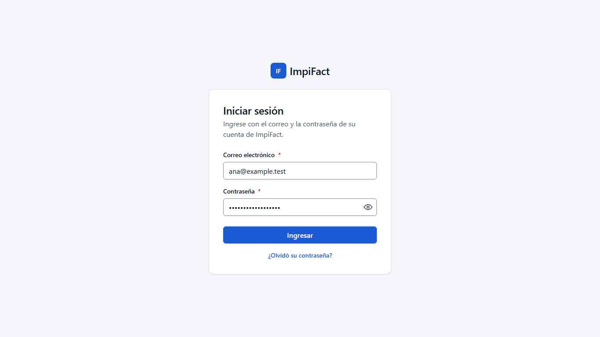

Si el correo o la contraseña no son correctos, el panel muestra «El correo o la contraseña no son correctos.». Después de varios intentos fallidos debe esperar un minuto antes de intentar de nuevo.

### Recuperar la contraseña

1. En la pantalla de inicio de sesión, haga clic en «¿Olvidó su contraseña?».
2. Escriba el correo de su cuenta y haga clic en «Enviar el enlace».
3. Abra el correo que recibe y siga el enlace. El enlace vence en 30 minutos y solo sirve una vez.
4. Escriba la **Contraseña nueva** (entre 10 y 256 caracteres), repítala en **Confirme la contraseña nueva** y haga clic en «Guardar la contraseña».

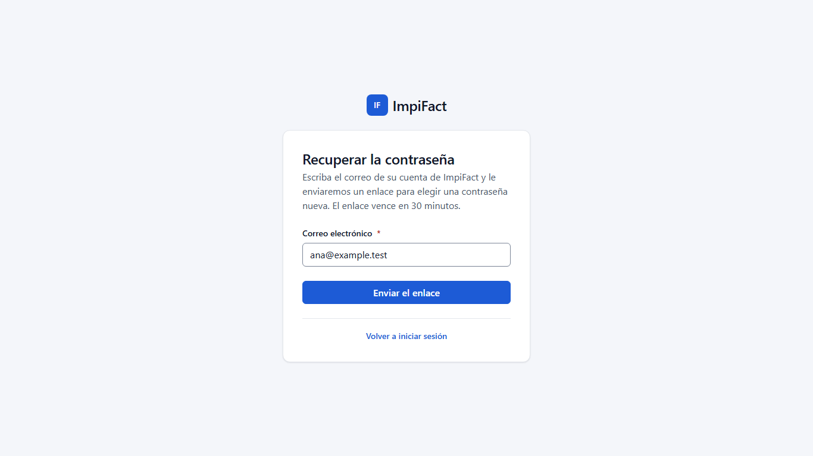

> **Nota:** por seguridad, el panel muestra el mismo mensaje exista o no el correo. Si no recibe el enlace, revise la carpeta de correo no deseado. Al guardar la contraseña nueva se cierran todas sus sesiones abiertas.

### Elegir la empresa

Si su cuenta trabaja con varias empresas, después de ingresar el panel le pide elegir una:

1. Busque la empresa en la lista **Seleccionar empresa**. Cada empresa aparece en una tarjeta con su inicial, su razón social y su NIT.
2. Haga clic en cualquier parte de la tarjeta de la empresa.

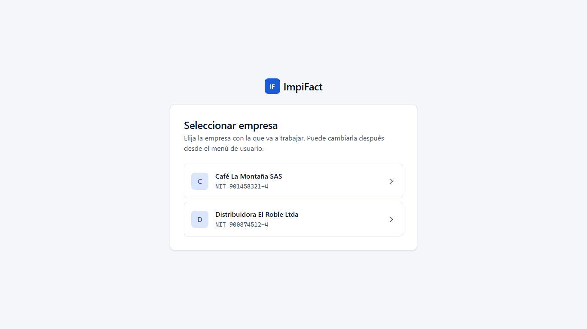

La tarjeta de la empresa con la que ya está trabajando dice «Empresa activa». Una empresa marcada «Empresa inactiva» no se puede elegir: debajo dice «La plataforma desactivó esta empresa: nadie puede trabajar en ella hasta que la reactive.». Pida al administrador de la plataforma que la reactive.

Todo lo que haga después (emitir, consultar, configurar) se hace sobre esa empresa, la **empresa activa**. Para cambiarla, abra el menú de su cuenta y elija «Cambiar de empresa».

## La pantalla del panel

La pantalla tiene tres partes:

1. **La barra lateral**, a la izquierda, con las secciones agrupadas: «Inicio»; **Emisión** («Nueva factura», «Nota crédito», «Nota débito»); **Consulta** («Documentos», «Clientes», «Productos»), y **Ajustes** («Empresa», «Paso a producción», «Usuarios», «Llaves de API», «Mi plan», «Avisos»). Solo aparecen las secciones que su rol permite.
2. **La barra superior**, con el nombre de la empresa activa, el botón de la luna o el sol (cambia entre el modo claro y el oscuro), «Ayuda» (abre este manual en PDF en otra pestaña), la campana de avisos (con el número de avisos sin leer) y el menú de su cuenta.
3. **El contenido** de la sección elegida.

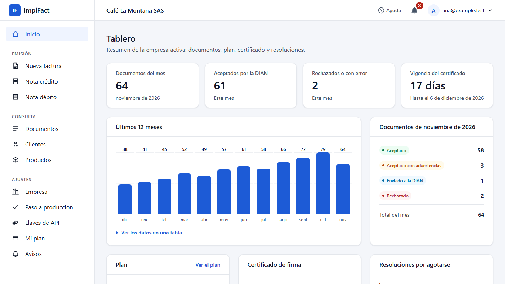

El menú de su cuenta, a la derecha de la barra superior, muestra su correo y las opciones «Cambiar de empresa» (si trabaja con varias) y «Cerrar sesión».

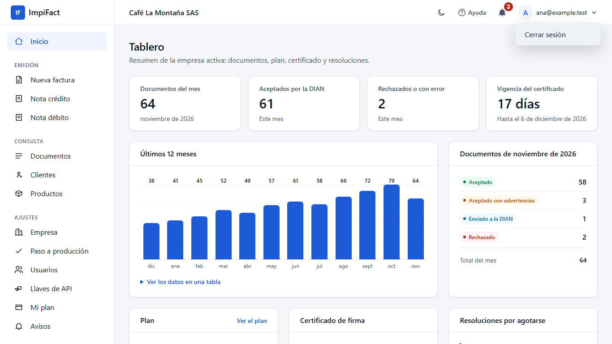

### En el celular o la tableta

En pantallas angostas la barra lateral se oculta. Toque el botón de menú (las tres líneas, arriba a la izquierda) para abrirla y la «X» para cerrarla.

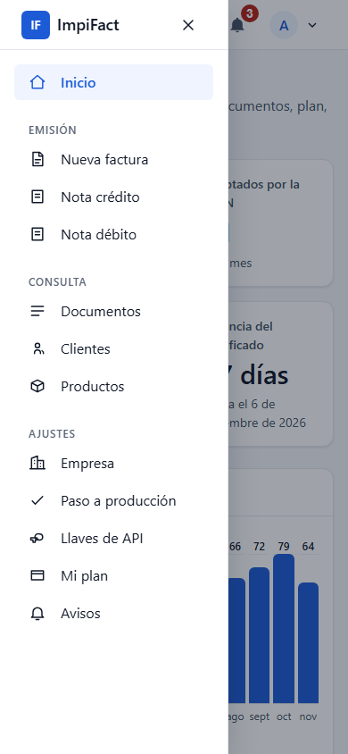

### Modo claro y oscuro

El panel abre en modo claro. Para trabajar con colores oscuros, haga clic en la luna de la barra superior; para volver al modo claro, haga clic en el sol. El panel recuerda su elección en ese navegador, también en la pantalla de inicio de sesión.

### Campos, listas y fechas

- **Ayuda de cada campo:** el ícono de información (una «i» en un círculo) junto al nombre del campo explica qué escribir. Pase el puntero sobre él, selecciónelo con el teclado o tóquelo en el celular.
- **Ejemplos:** los campos vacíos muestran en gris un ejemplo de lo que se espera (por ejemplo, «Calle 10 # 20-30» en la dirección). El ejemplo no se guarda: escriba el dato real.
- **Listas:** haga clic en la lista y elija una opción. Las listas largas traen un buscador arriba: escriba parte del nombre y elija en los resultados.
- **Fechas:** escriba la fecha como dd/mm/aaaa o haga clic en el calendario y elija el día.
- **Ruta de la página:** arriba del título de algunas páginas aparece la ruta, por ejemplo «Clientes › Nuevo cliente». Haga clic en «Clientes» para volver a la lista.
- **Cambios sin guardar:** si sale de un formulario sin guardar lo que escribió, el panel pregunta en el diálogo **Cambios sin guardar**. «Seguir editando» lo deja en el formulario con lo que escribió; «Salir sin guardar» descarta los cambios.
- **Campos obligatorios:** llevan un asterisco rojo (*). Si falta uno al guardar, el panel lo marca en rojo con el mensaje «Este campo es obligatorio.».
- **Mensajes del panel:** cuando algo se guarda o falla, el panel muestra un mensaje arriba a la derecha, debajo de la barra superior, con un ícono según su tipo (confirmación, información, advertencia o error). Los de confirmación e información se cierran solos después de unos segundos; los de advertencia y error quedan hasta que usted los cierre con la «X» del mensaje.

## Administración de la plataforma

Esta sección es solo para el administrador de la plataforma. Su barra lateral muestra el grupo **Plataforma**, con «Planes» y «Empresas», y la barra superior dice «Administración de la plataforma».

### Crear una empresa

1. En la barra lateral, haga clic en «Empresas». Verá la lista **Empresas de la plataforma**, con su plan actual y su estado. Use **Buscar empresa** para encontrar una por razón social o NIT.
2. Haga clic en «Nueva empresa».
3. Llene los datos de la empresa tal como aparecen en su RUT:
   - **NIT**: solo dígitos, sin puntos ni dígito de verificación. El **Dígito de verificación** se calcula solo.
   - **Razón social**, **Tipo de identificación**, **Tipo de organización** y **Régimen**.
   - **Responsabilidades fiscales**: marque al menos una.
   - **Departamento** y **Municipio**: abra la lista, escriba parte del nombre en el buscador y elíjalo. El municipio queda bloqueado hasta que elija el departamento.
   - **Dirección**, **Teléfono** (entre 7 y 10 dígitos), **Correo electrónico** y **Matrícula mercantil** (si no tiene, escriba 0000000-00).
4. Haga clic en «Crear empresa».

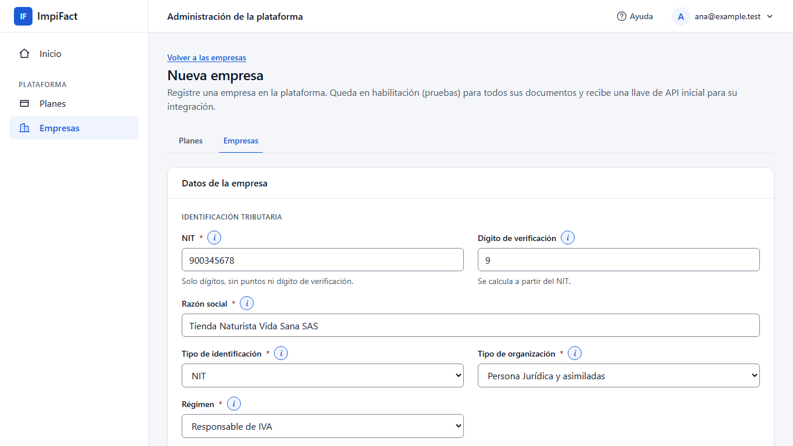

> **Consejo:** cada campo tiene un ícono de información (una «i» en un círculo) con una explicación de qué escribir. Pase el puntero sobre él o selecciónelo con el teclado.

La empresa nueva queda en habilitación (pruebas) para todos sus documentos y recibe una llave de API inicial para su integración.

### Guardar la llave de la empresa

Al crear la empresa, el panel muestra el diálogo **Copie la llave de la empresa**.

1. Haga clic en «Copiar llave» y guárdela en un lugar seguro.
2. Haga clic en «Ya la copié».

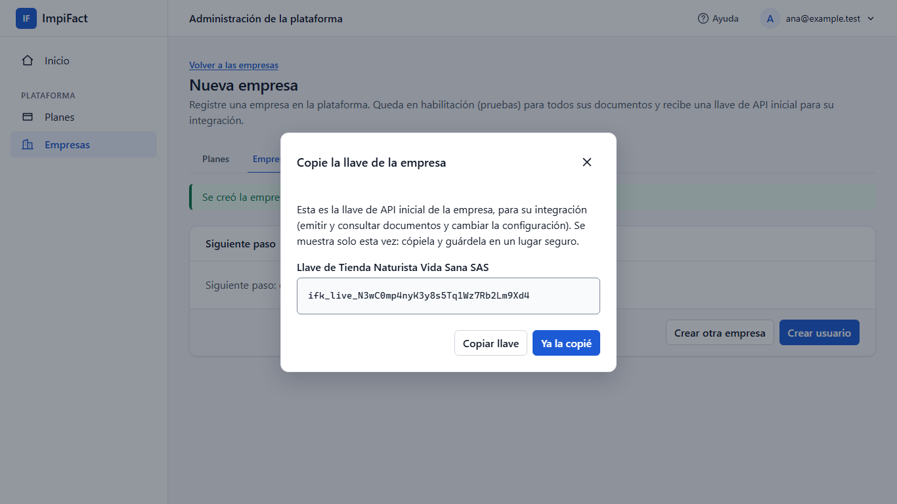

> **Importante:** la llave se muestra solo esta vez. Después de cerrar el diálogo no se puede volver a ver.

### Crear el primer dueño

Enseguida el panel abre **Crear usuario** para la empresa nueva. El dueño es quien configura la empresa y crea los demás usuarios.

1. Escriba el **Correo electrónico**, el **Nombre** y, si quiere, el **Teléfono** de la persona.
2. Escriba una **Contraseña** de al menos 10 caracteres.
3. Deje el **Rol** en «Dueño» (o elija «Vendedor» para crear un vendedor).
4. Haga clic en «Crear usuario».

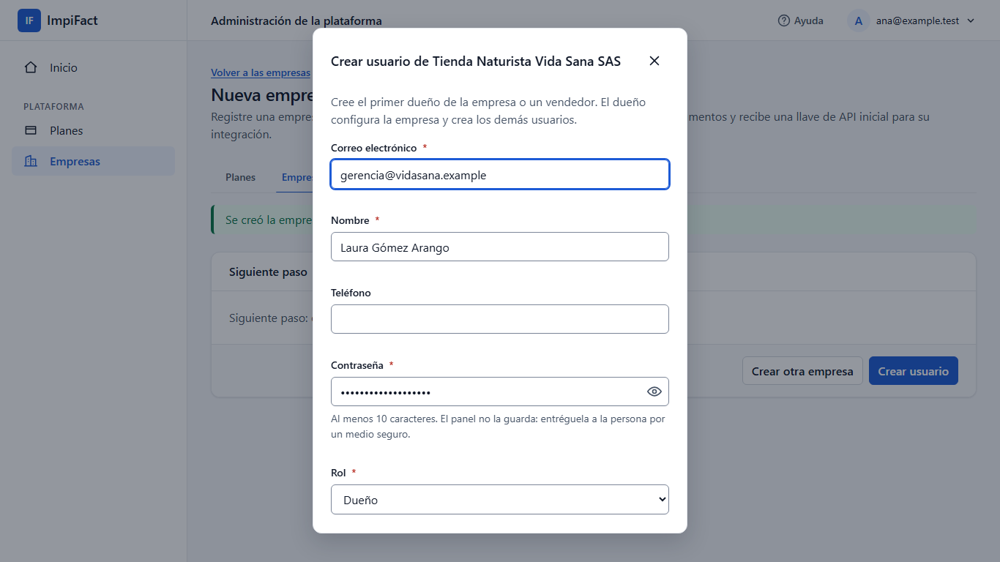

> **Nota:** el panel no guarda la contraseña. Entréguela a la persona por un medio seguro. Para crear más usuarios de una empresa ya creada, abra «Acciones» en su fila de la lista de empresas y elija «Crear usuario».

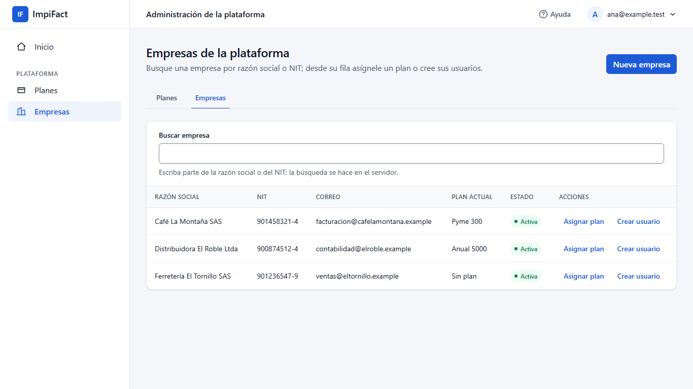

Cada fila tiene un botón «Acciones» con «Asignar plan», «Crear usuario» y «Usuarios», y además «Desactivar» si la empresa está activa o «Reactivar» si está inactiva.

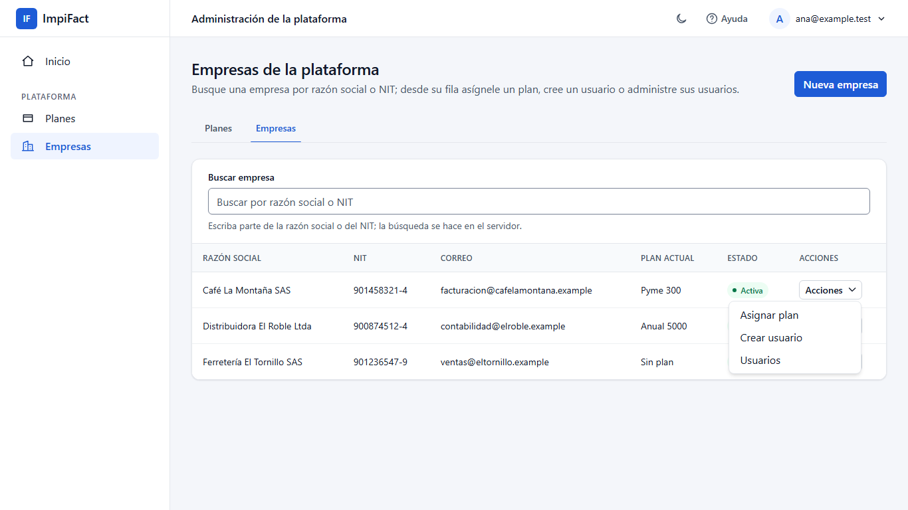

### Administrar los usuarios de una empresa

1. En «Empresas», busque la empresa, abra «Acciones» en su fila y elija «Usuarios».
2. Se abre la página de usuarios de esa empresa, por ejemplo **Usuarios de Café La Montaña SAS**, con la ruta «Empresas de la plataforma › Usuarios de Café La Montaña SAS». Haga clic en «Empresas de la plataforma» para volver a la lista.
3. Desde ahí cree usuarios con «Nuevo usuario», cambie su rol, desactívelos o reactívelos, igual que el dueño de la empresa (vea «Usuarios de la empresa»).

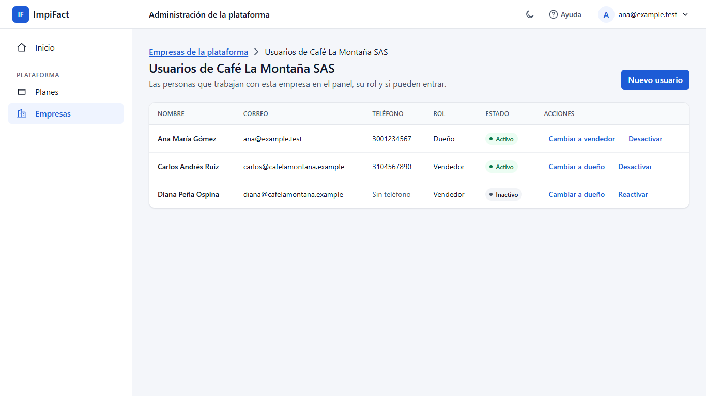

Como el administrador de la plataforma no es usuario de la empresa, todas las filas muestran sus acciones, también las de los dueños.

### Desactivar o reactivar una empresa

Una empresa nunca se borra: sus facturas son documentos fiscales y se conservan. En su lugar se desactiva.

1. En «Empresas», busque la empresa, abra «Acciones» en su fila y elija «Desactivar».
2. El panel pregunta «¿Desactivar …?» y explica qué pasa: la empresa deja de emitir documentos, sus API keys se revocan para siempre y sus usuarios pierden el acceso (se cierran sus sesiones y ya no pueden elegirla). Las facturas y demás documentos se conservan.
3. Haga clic en «Desactivar empresa» para seguir, o en «Cancelar» para dejarla como está.

La fila pasa a «Inactiva» sin recargar la página, y el panel dice cuántas API keys se revocaron y a cuántos usuarios se les cerró la sesión. Lo ya enviado a la DIAN se sigue consultando; lo que faltaba enviar espera a que la empresa se reactive.

Para que vuelva a trabajar, abra «Acciones» en su fila, elija «Reactivar» y confirme con «Reactivar empresa». Sus usuarios pueden volver a elegirla, pero las API keys revocadas no vuelven: un dueño de la empresa debe crear llaves nuevas.

> **Nota:** solo el administrador de la plataforma puede desactivar o reactivar una empresa.

### Planes

Un plan define cuántos documentos de cada familia puede emitir una empresa en cada periodo. Un documento cuenta cuando la DIAN lo acepta; al llegar al límite, la emisión se rechaza.

1. En la barra lateral, haga clic en «Planes». Verá la lista **Planes de la plataforma** con el periodo, las cantidades por familia y el estado de cada plan.
2. Para crear uno, haga clic en «Nuevo plan». Para cambiar uno existente, haga clic en «Editar» en su fila.
3. Escriba el **Nombre** (no se puede repetir), elija el **Periodo** («Mensual», «Anual» o «Paquete») y escriba los **Documentos por periodo** de cada familia (0 = la empresa no puede emitir documentos de esa familia).
4. Deje marcado **Plan activo** y haga clic en «Guardar».

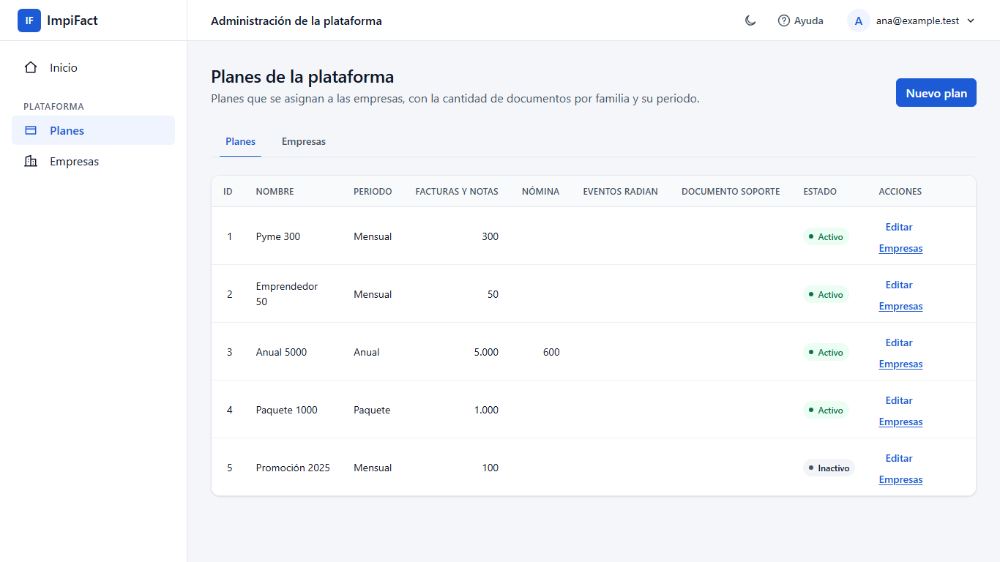

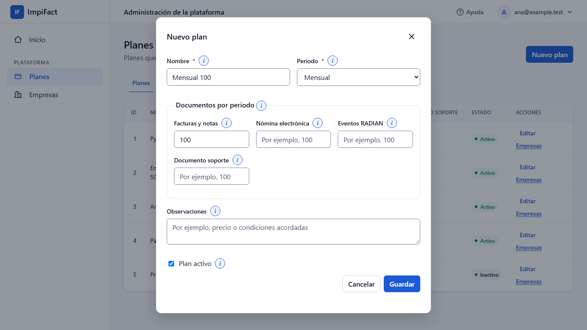

> **Nota:** un plan inactivo no deja emitir a las empresas que lo tienen asignado. Para suspender un plan sin borrarlo, desmarque **Plan activo**. Con «Empresas», en la fila de un plan, ve qué empresas lo tienen.

### Asignar un plan a una empresa

1. En «Empresas», busque la empresa, abra «Acciones» en su fila y elija «Asignar plan».
2. Elija el **Plan** y haga clic en «Asignar plan».

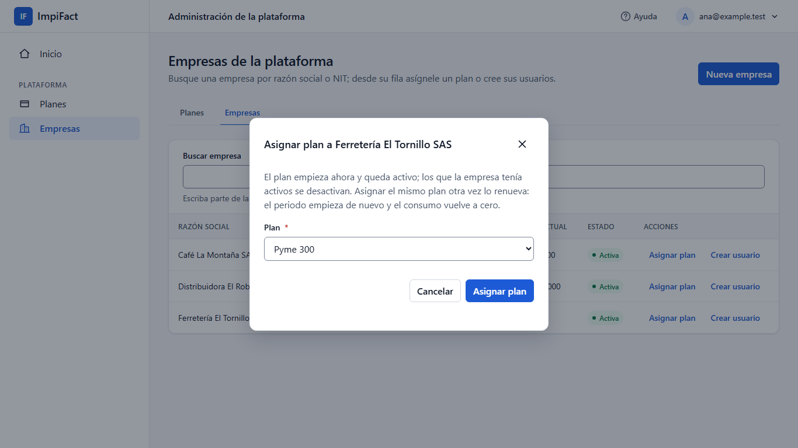

El plan empieza en ese momento y queda activo; los que la empresa tenía activos se desactivan. Asignar el mismo plan otra vez lo renueva: el periodo empieza de nuevo y el consumo vuelve a cero.

## Configurar la empresa

Antes de facturar, el dueño completa la configuración de la empresa. En la barra lateral, haga clic en «Empresa». La pantalla **Configuración de la empresa** tiene seis pestañas: «Datos», «Ambientes», «Software», «Certificado», «Resoluciones» y «Paso a producción».

### Datos de la empresa

1. Abra la pestaña «Datos».
2. Revise o complete la identificación tributaria (razón social, tipo de identificación, tipo de organización, régimen y responsabilidades fiscales) y la ubicación y contacto (departamento, municipio, dirección, teléfono, correo electrónico y matrícula mercantil).
3. Haga clic en «Guardar». El panel confirma con «Los cambios se guardaron.».

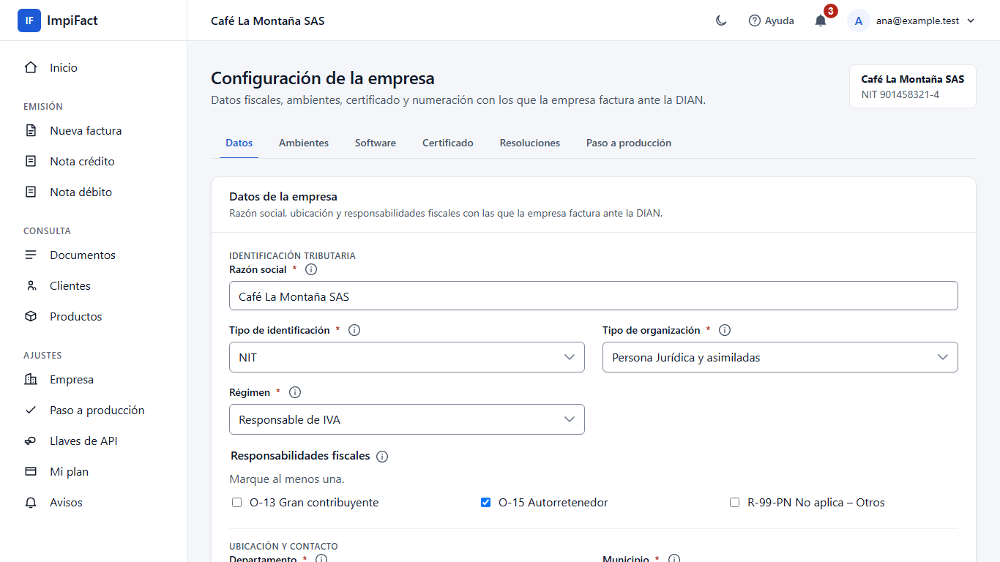

La dirección y el correo salen en los documentos electrónicos que emita.

### Ambientes

Cada familia de documentos se envía a la DIAN en **Habilitación (pruebas)** o en **Producción**. La pestaña «Ambientes» muestra el ambiente actual de cada familia. En **Cambiar de ambiente** elija solo las familias que cambian; las demás quedan como están.

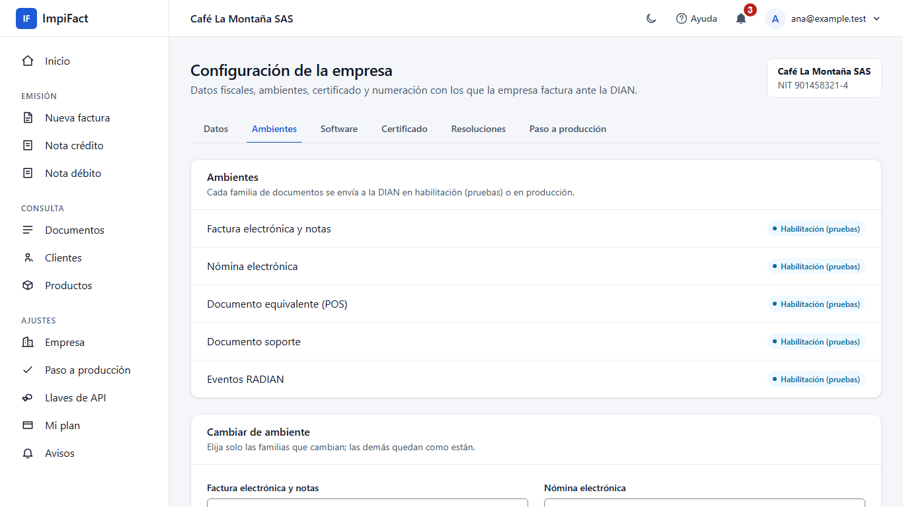

> **Advertencia:** pasar una familia a producción es un paso sin vuelta atrás. Lea la sección «Paso a producción» antes de hacerlo.

### Software

En la pestaña «Software» registre los datos que la DIAN le asignó a la empresa en su portal de habilitación:

1. **Identificador del software**: el que aparece en el portal de la DIAN, en «Configurar modos de operación».
2. **PIN del software**: cinco dígitos. No se vuelve a mostrar después de guardar; si lo deja vacío, se conserva el PIN guardado.
3. **Identificador del set de pruebas (TestSetId)**: lo da la DIAN al asociar el software en habilitación.
4. Haga clic en «Guardar». El software queda en la tabla **Software registrado**.

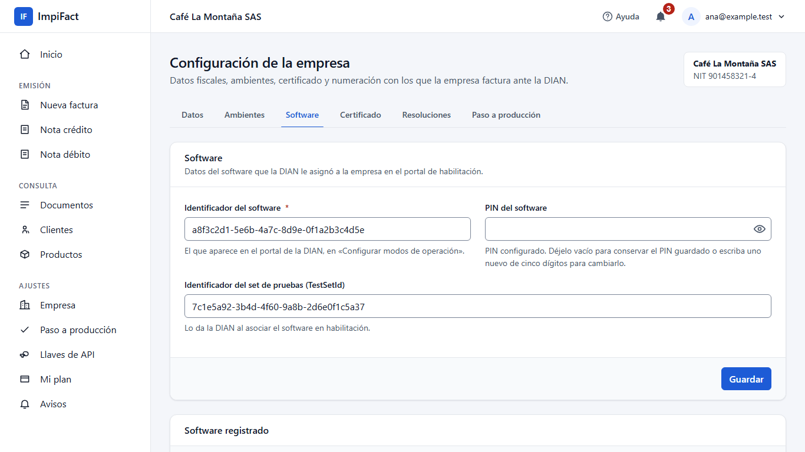

### Certificado digital

Los documentos se firman con el certificado de firma digital de la empresa (archivo .p12 o .pfx).

1. Abra la pestaña «Certificado». Verá los certificados de la empresa, con su titular, emisor, fecha de vencimiento y días restantes.
2. En **Cargar un certificado**, haga clic en «Seleccionar archivo» y elija el **Archivo del certificado** (.p12 o .pfx, máximo 1 MB). Si el archivo no es de ese tipo o pesa más, el panel lo avisa enseguida.
3. Escriba la **Contraseña del certificado**.
4. Haga clic en «Cargar certificado». El panel confirma cuántos días le quedan de vigencia.

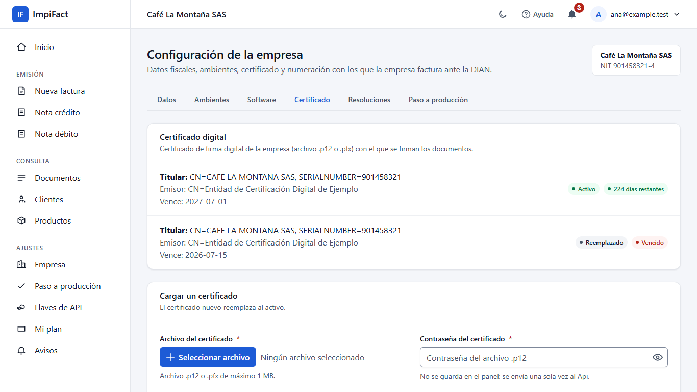

> **Nota:** el certificado nuevo reemplaza al activo. La contraseña no se guarda en el panel. Renueve el certificado antes de que venza: sin un certificado vigente no se pueden firmar ni enviar documentos.

### Resoluciones de numeración

La pestaña «Resoluciones» guarda los rangos de numeración que la DIAN autorizó para cada tipo de documento.

1. Abra la pestaña «Resoluciones».
2. En **Agregar o actualizar una resolución**, elija el **Tipo de documento** y escriba el **Prefijo**, el **Número de resolución**, la **Fecha de la resolución**, la **Clave técnica** (solo para facturas), el rango (**Desde el número**, **Hasta el número**) y la vigencia (**Vigente desde**, **Vigente hasta**).
3. Haga clic en «Guardar resolución». La resolución aparece en la tabla, con el próximo número, cuántos números quedan y los días de vigencia.

**Ejemplo de habilitación.** Mientras la empresa está en habilitación, la DIAN usa el prefijo SETP con la resolución 18760000001, del 990000000 al 995000000. Haga clic en «Usar el ejemplo de habilitación (SETP)» y el panel llena el formulario con esos datos; luego haga clic en «Guardar resolución».

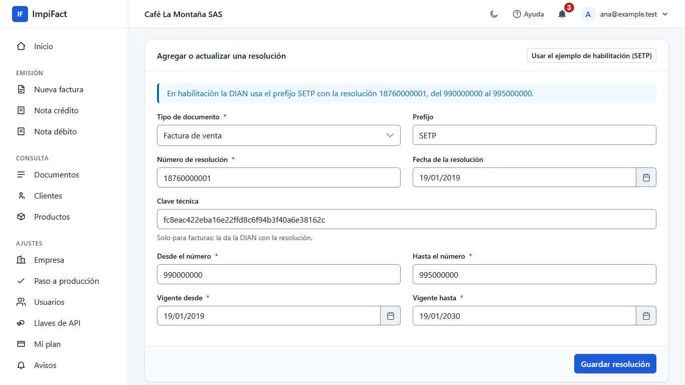

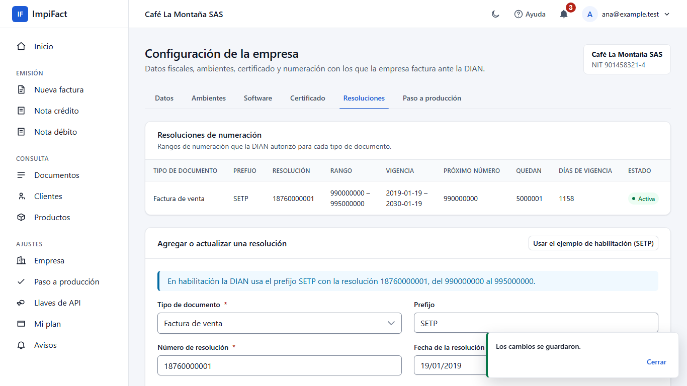

Otras opciones de esta pestaña:

- **Rangos autorizados en la DIAN**: «Consultar en la DIAN» muestra los rangos que la DIAN tiene registrados para el software de la empresa; «Usar este rango» los copia al formulario.
- «Cambiar próximo número»: úselo si la empresa viene de otro sistema de facturación o ya usó números del rango. El número debe estar dentro del rango y no puede ser menor que el próximo número actual.

### Paso a producción

La pestaña «Paso a producción» (también en la barra lateral) es un asistente con seis pasos en orden. Cada paso muestra si está «Completo», «Pendiente», «En curso» o «Bloqueado», y un enlace para ir a la sección donde se completa.

1. **Datos de la empresa**: los datos obligatorios están completos.
2. **Certificado digital**: hay un certificado activo y vigente.
3. **Resolución de numeración**: la factura de venta tiene una resolución vigente, con clave técnica, en el ambiente actual (en habilitación, la de prefijo SETP).
4. **Software y set de pruebas**: el software y el identificador del set de pruebas están guardados.
5. **Set de pruebas de la DIAN**: envía facturas de prueba al set de pruebas.
6. **Producción**: pasa cada familia de documentos a producción.

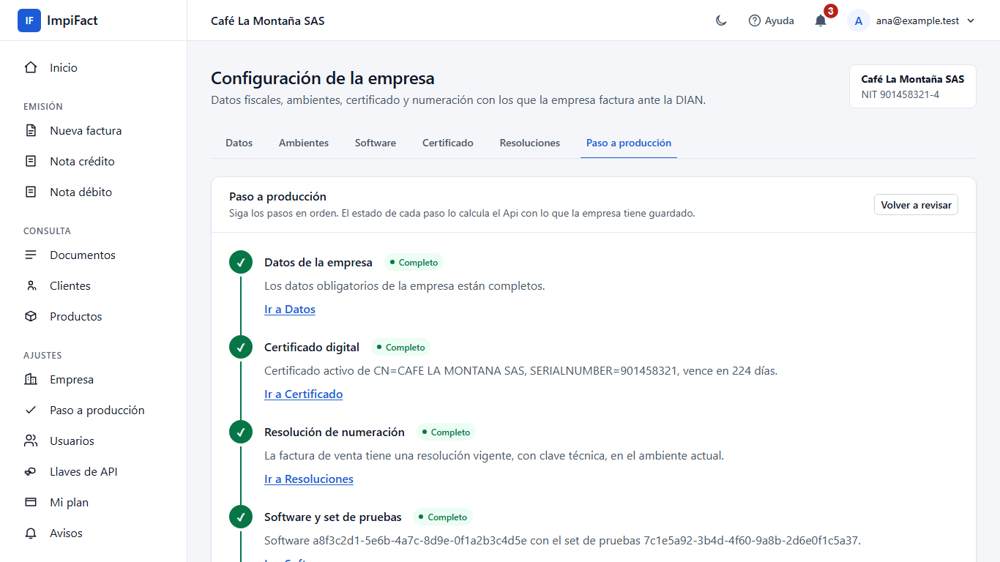

Para el set de pruebas:

1. En el paso **Set de pruebas de la DIAN**, haga clic en «Enviar factura de prueba». El panel envía una factura de ejemplo (1 unidad de 10.000 pesos con IVA del 19 % a consumidor final).
2. Espere el resultado, por ejemplo «Factura SETP990000000: Aceptada». La DIAN aprueba el set cuando recibe todos los documentos que pide; puede enviar varias.
3. Si cambió algo en otra pestaña, haga clic en «Volver a revisar» para actualizar el estado de los pasos.

Cuando la DIAN aprueba el set, el paso muestra «La DIAN ya aprobó el set de pruebas.» y ya no ofrece enviar más facturas de prueba. Si el set ya estaba aprobado (por ejemplo, porque lo completó con otro sistema), la primera factura que envíe le trae esa respuesta de la DIAN: esa factura queda rechazada, porque la DIAN ya no valida documentos de un set aprobado, y el paso queda completo.

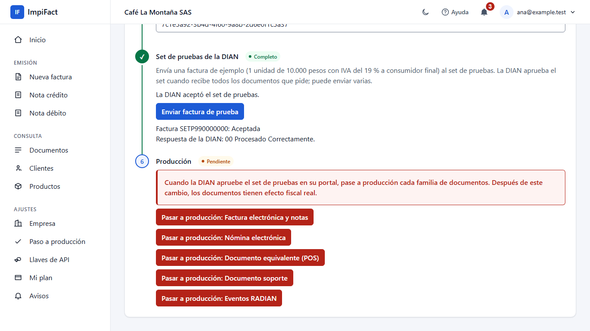

Cuando la DIAN apruebe el set de pruebas en su portal, pase a producción.

> **Advertencia: este paso no se puede deshacer.** Al pasar a producción, la DIAN registra la fecha de inicio de la facturación en producción de la empresa y ese registro no se revierte. Desde ese momento cada documento tiene efecto fiscal real ante la DIAN y no se puede borrar: solo se corrige con notas. Antes de confirmar, verifique los datos de la empresa y el certificado, y tenga a mano la resolución de numeración de producción que le autorizó la DIAN para registrarla en «Resoluciones».

Para pasar a producción:

1. En el paso **Producción**, haga clic en el botón de la familia que va a pasar, por ejemplo «Pasar a producción: Factura electrónica y notas».
2. Lea el diálogo **Confirmar el paso a producción**.
3. Marque «Entiendo que los documentos tendrán efecto fiscal real.».
4. Haga clic en «Pasar a producción».

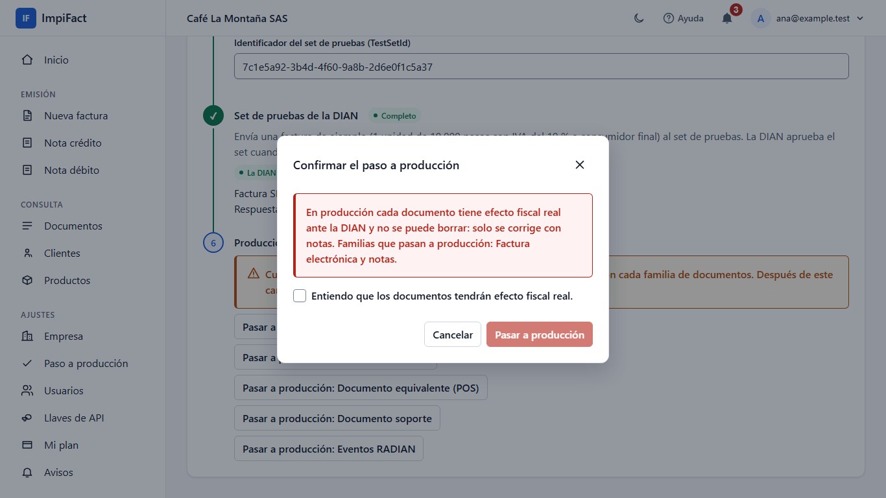

## Usuarios de la empresa

El dueño administra las personas que trabajan con la empresa en el panel. En la barra lateral, en **Ajustes**, haga clic en «Usuarios». Solo los dueños ven esta sección.

La página **Usuarios** muestra el **Nombre**, el **Correo**, el **Teléfono**, el **Rol** («Dueño» o «Vendedor») y el **Estado** («Activo» o «Inactivo») de cada usuario. Su propia fila dice «(usted)» y no tiene acciones: «Es su cuenta: no puede cambiar su rol ni desactivarla.».

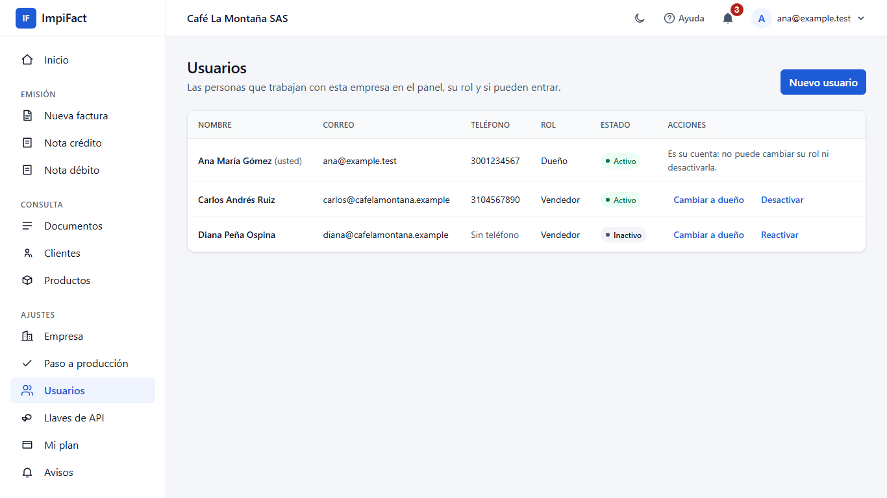

### Crear un usuario

1. Haga clic en «Nuevo usuario».
2. Escriba el **Correo electrónico** y el **Nombre** de la persona y, si quiere, su **Teléfono**.
3. Escriba una **Contraseña** de al menos 10 caracteres.
4. Elija el **Rol**: «Dueño» configura la empresa y administra los usuarios; «Vendedor» emite y consulta documentos. Viene en «Vendedor».
5. Haga clic en «Crear usuario». El usuario aparece en la lista y ya puede iniciar sesión.

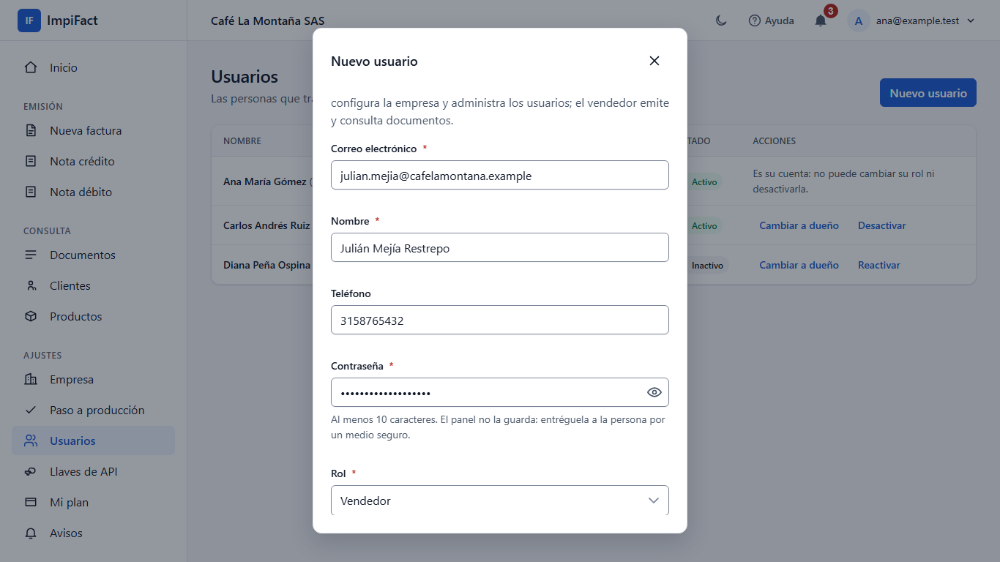

> **Nota:** el panel no guarda la contraseña. Entréguela a la persona por un medio seguro.

### Cambiar el rol, desactivar o reactivar un usuario

En la fila del usuario:

- «Cambiar a dueño» o «Cambiar a vendedor» cambia su rol enseguida.
- «Desactivar» le quita el acceso. Lea el diálogo de confirmación y haga clic en «Desactivar». La persona pierde el acceso a esta empresa y se cierran sus sesiones abiertas. Los documentos que emitió conservan su autor.
- «Reactivar» le devuelve el acceso a un usuario inactivo.

> **Importante:** la empresa siempre debe tener al menos un dueño activo. Si el cambio la dejaría sin dueño, el panel no lo hace y muestra «La empresa debe tener al menos un dueño activo: nombre otro dueño antes de hacer este cambio.».

Si otra persona cambió el mismo usuario al mismo tiempo, el panel muestra «Otra persona cambió estos datos al mismo tiempo; la lista se actualizó.» y actualiza la lista solo. Revise la lista y repita el cambio si todavía hace falta.

Las llaves de API no pueden administrar usuarios: hágalo desde el panel con su cuenta de dueño.

## Clientes y productos

Tener sus clientes y productos guardados hace más rápida la emisión: al facturar, los busca por nombre o código en lugar de escribirlos.

### Clientes

1. En la barra lateral, haga clic en «Clientes». Verá la lista con la identificación, el nombre, el correo y el estado de cada cliente. Use **Buscar por nombre o número de identificación** y **Estado** para filtrar.
2. Para crear uno, haga clic en «Nuevo cliente».
3. Elija el **Tipo de identificación** y escriba el **Número de identificación** (sin dígito de verificación; el **Dígito de verificación (DV)** se calcula solo).
4. Si quiere, haga clic en «Buscar en la DIAN»: si la DIAN tiene registrado al cliente, el panel llena el nombre y el correo. Revíselos antes de guardar.
5. Complete los datos tributarios y de ubicación y contacto. El **Correo para recibir facturas** es al que se envían los documentos.
6. Haga clic en «Guardar».

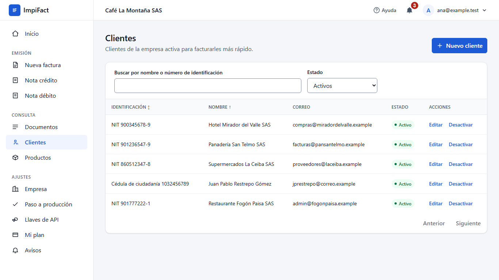

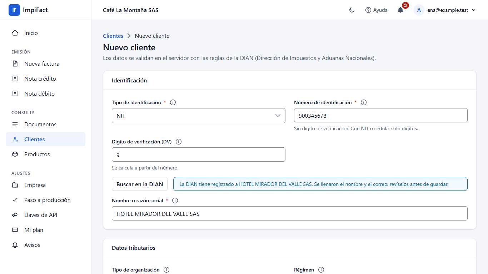

Para cambiar los datos de un cliente, haga clic en «Editar» en su fila. «Desactivar» lo oculta al emitir, pero no lo borra: los documentos emitidos lo conservan y puede reactivarlo después con «Reactivar».

### Productos y servicios

1. En la barra lateral, haga clic en «Productos». Verá la lista **Productos y servicios** con el código, el nombre, el precio unitario y el estado.
2. Para crear uno, haga clic en «Nuevo producto».
3. Escriba el **Código**, el **Nombre** y, si quiere, la **Descripción**.
4. Elija la **Unidad de medida**: abra la lista, escriba en el buscador el nombre o el código (por ejemplo KGM) y elíjala en los resultados.
5. Escriba el **Precio unitario sin impuestos**, con punto para los decimales (por ejemplo 12500.50).
6. Elija el **Impuesto** y su tarifa, o «Sin impuesto».
7. Haga clic en «Guardar».

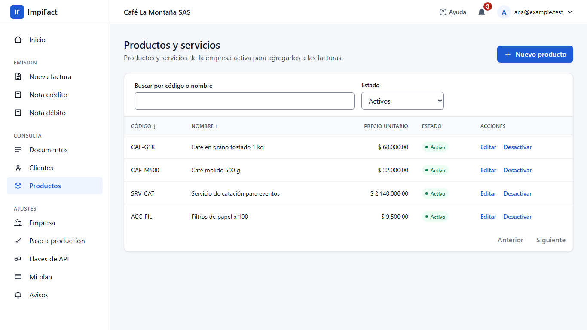

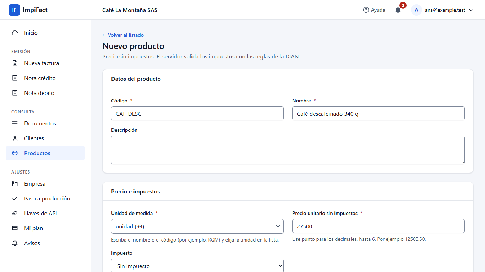

## Emitir documentos

### Emitir una factura

1. En la barra lateral, haga clic en «Nueva factura» (o en «Emitir factura» en la lista de documentos).
2. En **Cliente**, escriba la identificación o el nombre en **Buscar cliente** y haga clic en «Elegir» junto al cliente. Si no existe, use «Crear un cliente nuevo».
3. En **Pago**, elija la **Forma de pago** («Contado» o «Crédito») y el **Medio de pago**. A crédito, escriba también la **Fecha de vencimiento** y el **Plazo en días**.
4. En **Líneas**, busque cada producto en **Agregar un producto** y haga clic en «Agregar». Ajuste la **Cantidad**, el precio o el IVA de cada línea si hace falta. Para algo que no está en sus productos, use «Agregar línea libre».
5. Si quiere, escriba **Notas**; aparecen en el PDF de la factura.
6. Revise el recuadro **Totales calculados por el servidor**: subtotal, impuestos y **Total a pagar** los calcula ImpiFact con las reglas de la DIAN.
7. Haga clic en «Emitir factura».

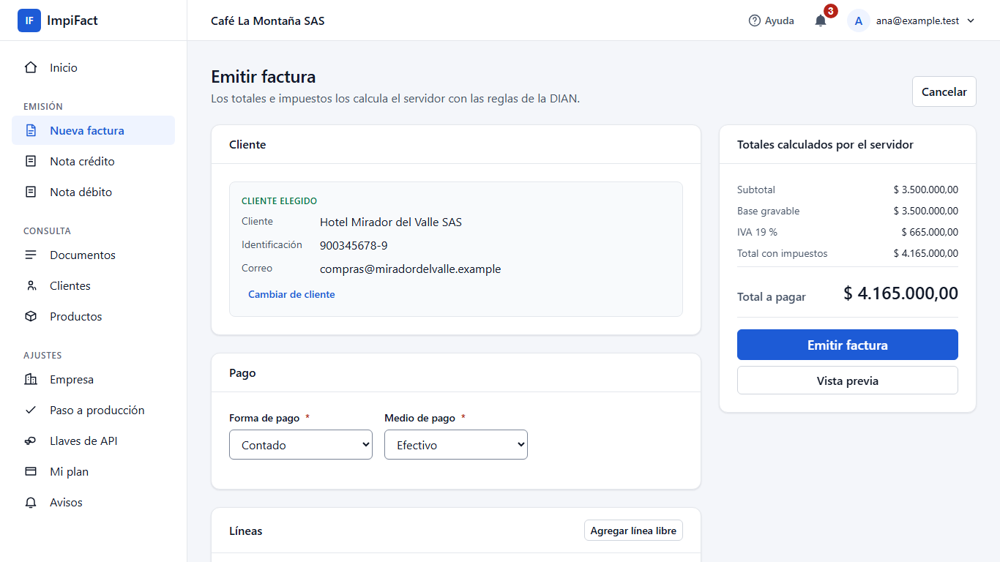

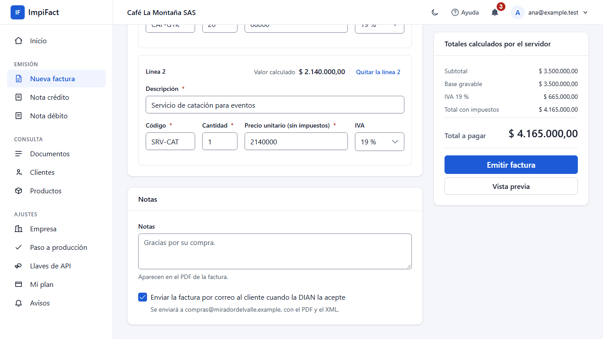

> **Nota:** el botón «Emitir factura» se habilita cuando hay cliente, las líneas están completas y llegaron los totales. Si falta algo, el panel lo indica: «Para emitir elija el cliente, complete las líneas y espere los totales del servidor.».

**Vista previa.** Antes de emitir, «Vista previa» muestra el PDF de la factura en un diálogo, sin enviarla a la DIAN. Desde ahí puede descargarlo con «Descargar PDF».

**Envío por correo.** La casilla «Enviar la factura por correo al cliente cuando la DIAN la acepte» viene marcada si el cliente tiene correo. Se le envía, con el PDF y el XML, cuando la DIAN acepta la factura. Si el cliente no tiene correo, agréguelo en su ficha.

Después de emitir, el panel abre el detalle de la factura y muestra «Consultando el estado en la DIAN…» mientras espera la respuesta. No necesita recargar la página: el estado se actualiza solo.

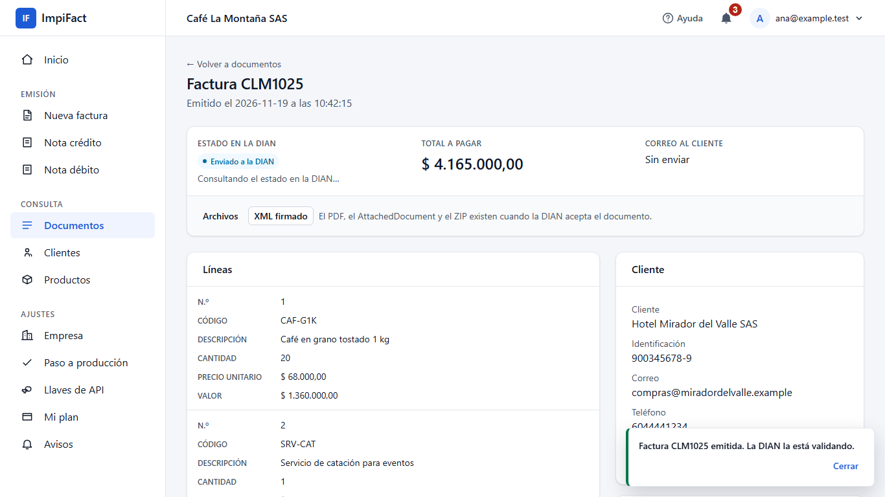

### Emitir una nota crédito

La nota crédito anula o rebaja una factura aceptada por la DIAN.

1. Abra el detalle de la factura (desde «Documentos») y haga clic en «Emitir nota crédito». También puede hacer clic en «Nota crédito» en la barra lateral y buscar la factura en **Buscar factura**.
2. Revise la **Factura que se corrige**.
3. Elija el **Concepto de la corrección**, por ejemplo «Anulación de factura electrónica» o «Devolución parcial de los bienes y/o no aceptación parcial del servicio».
4. Revise las **Líneas**: al partir de una factura, el panel copia sus líneas. Ajuste cantidades o quite líneas para una devolución parcial. «Copiar las líneas de la factura» las vuelve a copiar.
5. Haga clic en «Emitir nota crédito».

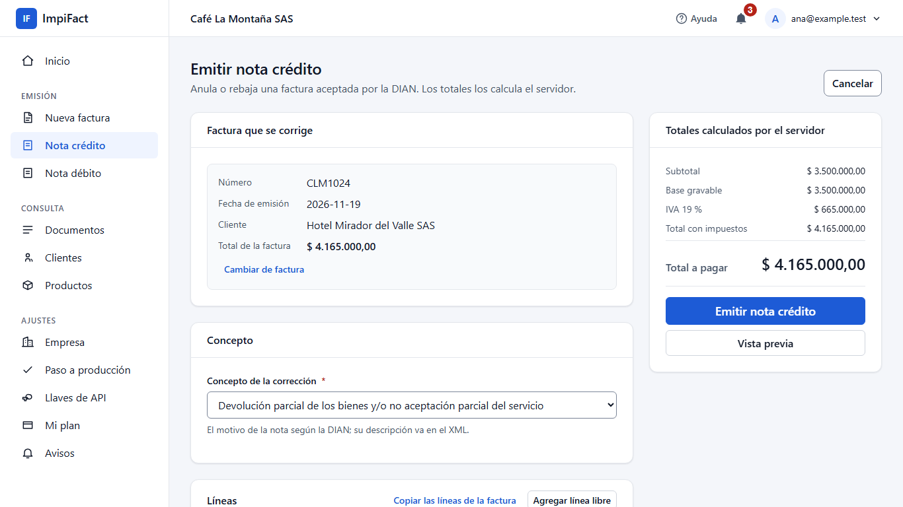

### Emitir una nota débito

La nota débito suma cargos (intereses, gastos) a una factura aceptada por la DIAN.

1. En la barra lateral, haga clic en «Nota débito».
2. En **Buscar factura**, escriba el número (con o sin prefijo) o el nombre del cliente y elija la factura. Solo aparecen las facturas aceptadas por la DIAN.
3. Elija el **Concepto de la corrección**, por ejemplo «Intereses» o «Gastos por cobrar».
4. Agregue las líneas con «Agregar línea libre»: **Código**, **Descripción**, **Cantidad** y **Precio unitario**.
5. Haga clic en «Emitir nota débito».

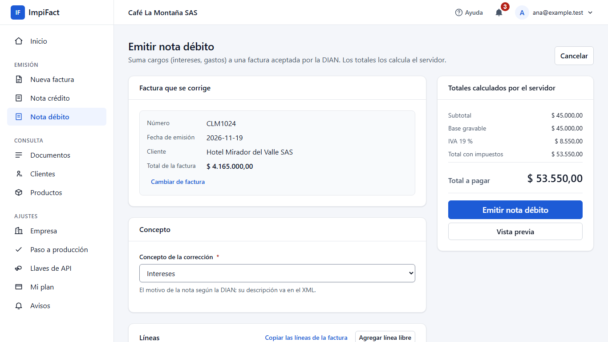

> **Nota:** las notas solo se emiten sobre facturas aceptadas por la DIAN. Si la factura todavía no está aceptada, el panel lo advierte y la nota se rechaza hasta que la DIAN la acepte.

## Consultar documentos

### Lista de documentos y filtros

En la barra lateral, haga clic en «Documentos». La lista muestra las facturas y notas de la empresa activa, de la más reciente a la más antigua, con su número, tipo, fecha, cliente, total y **Estado DIAN**. Use las flechas al pie de la lista para ver la página anterior o la siguiente.

Para filtrar:

1. Use **Desde** y **Hasta** (fechas), **Tipo de documento**, **Cliente** (identificación o nombre) y **Número** (con prefijo o solo los dígitos).
2. Para filtrar por estado, haga clic en «Más filtros» y marque uno o varios estados en **Estado DIAN**. Para ocultarlos de nuevo, haga clic en «Menos filtros».
3. Si quiere saber cuántos documentos cumplen los filtros, marque «Mostrar cuántos documentos hay».
4. Haga clic en «Aplicar filtros». «Limpiar filtros» los quita.

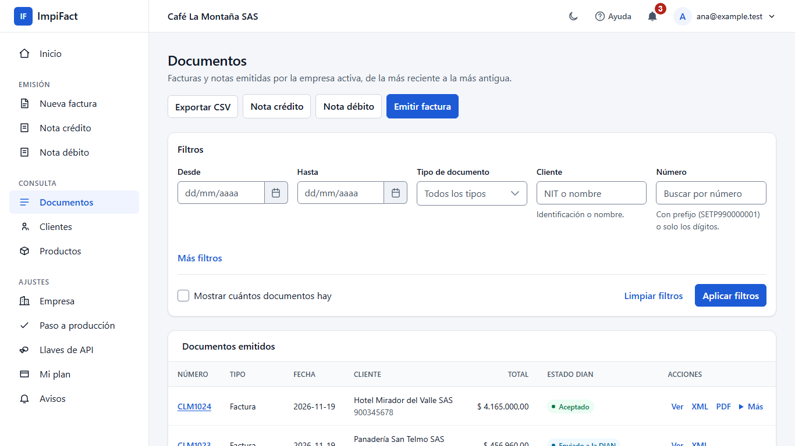

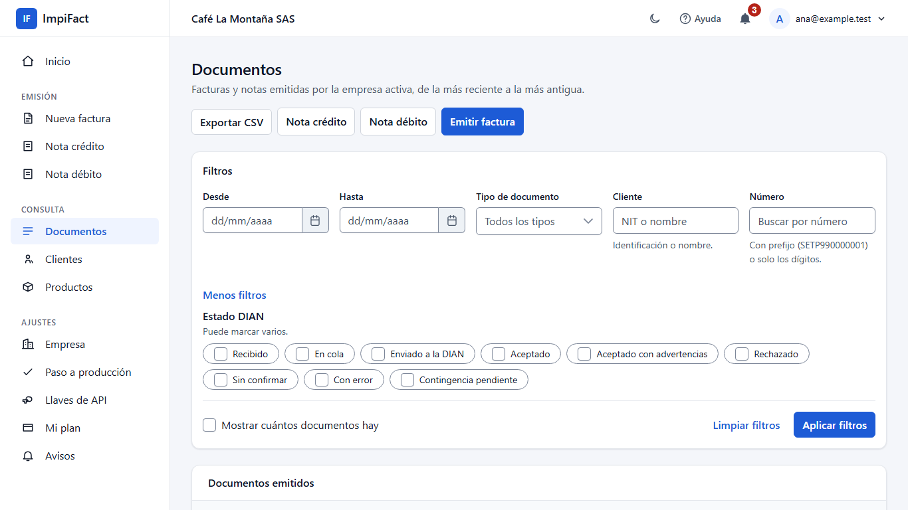

> **Consejo:** los filtros quedan en la dirección de la página. Puede guardarla en favoritos o compartirla para volver a la misma consulta.

### Exportar los documentos

1. En «Documentos», aplique los filtros de los documentos que necesita (por ejemplo, un rango de fechas).
2. Haga clic en «Exportar».
3. Elija el formato. El archivo trae los documentos que cumplen los filtros actuales:
   - «Excel (.xlsx)»: para trabajar con las cifras en una hoja de cálculo (sumar, filtrar, hacer tablas).
   - «CSV»: para importar los documentos en otros sistemas, como su programa contable.
   - «PDF»: un informe para imprimir o compartir. No trae la columna CUFE/CUDE y admite hasta 5.000 documentos.

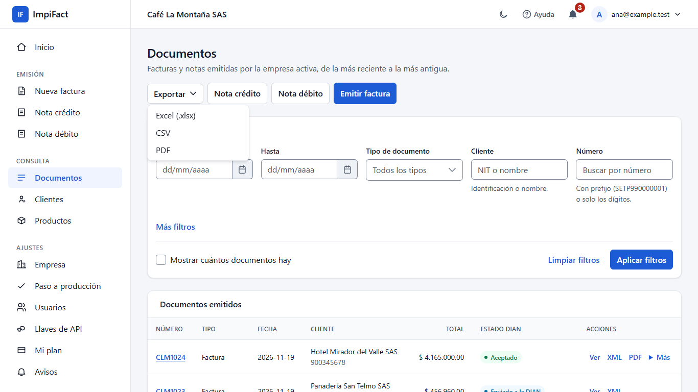

El panel confirma la descarga con un mensaje, por ejemplo «Se descargó el archivo de Excel.». Si la consulta tiene más documentos de los que admite el formato, el panel muestra «La exportación tiene demasiadas filas. Acote el rango de fechas e intente de nuevo.». Con más de 5.000 documentos, exporte a «Excel (.xlsx)» o use un rango de fechas más corto.

### Estados de la DIAN

| Estado                    | Qué significa                                                                                                         |
| ------------------------- | --------------------------------------------------------------------------------------------------------------------- |
| Recibido                  | ImpiFact recibió el documento y lo está preparando.                                                                   |
| En cola                   | El documento está firmado y espera su turno para enviarse a la DIAN. El XML firmado ya se puede descargar.            |
| Enviado a la DIAN         | El documento se envió y se espera la respuesta de la DIAN.                                                            |
| Aceptado                  | La DIAN validó el documento. Ya se pueden descargar su PDF, su AttachedDocument y el ZIP del correo.                  |
| Aceptado con advertencias | La DIAN lo aceptó, con observaciones que no impiden su validez. Revíselas en el detalle.                              |
| Rechazado                 | La DIAN no aceptó el documento. Revise el motivo en el detalle, corrija y emita un documento nuevo.                   |
| Sin confirmar             | La DIAN todavía no confirma el resultado. El panel sigue consultando.                                                 |
| Con error                 | El envío a la DIAN falló.                                                                                             |
| Contingencia pendiente    | El documento está en contingencia, pendiente de completar su envío a la DIAN.                                         |

El detalle muestra además el **Correo al cliente**: «Sin enviar», «Enviado» o «Con error».

### Detalle de un documento

Haga clic en el número del documento (o en «Ver») para abrir su detalle. Ahí encuentra:

- El **Estado en la DIAN**, el **Total a pagar** y el estado del **Correo al cliente**.
- **Archivos**: el «XML firmado» (desde que el documento quedó en cola) y, cuando la DIAN lo acepta, el «PDF», el «AttachedDocument» y el «ZIP del correo».
- Las **Líneas**, los **Totales** y los datos del **Cliente**.
- La **Respuesta de la DIAN**: código, mensaje y CUFE (código único de la factura).
- En una factura aceptada, los botones «Emitir nota crédito» y «Emitir nota débito».

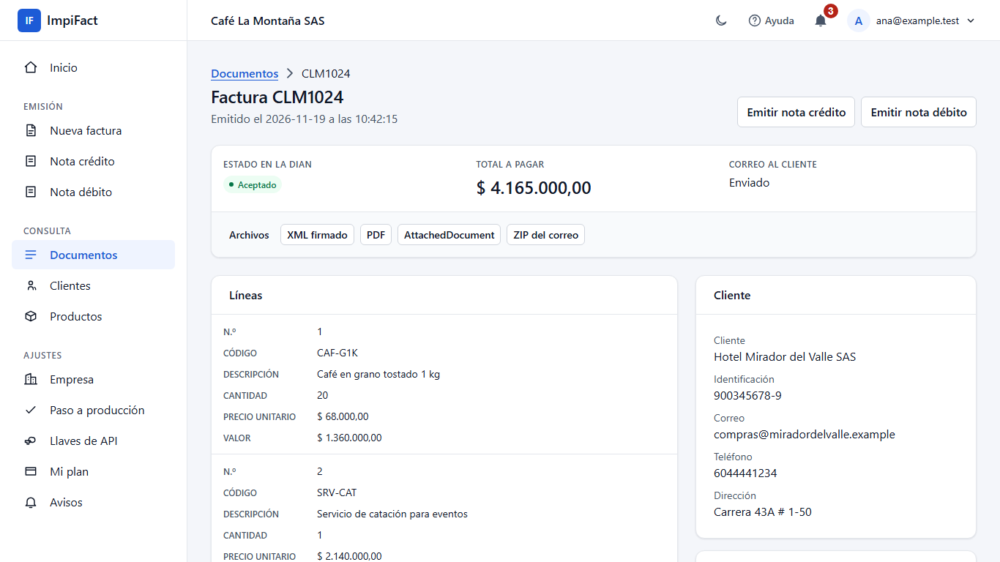

### Descargas y reenvío del correo

- Para descargar un archivo, haga clic en su botón en **Archivos** del detalle, o en «XML» o «PDF» en la fila de la lista.
- En **Acciones** del detalle de un documento aceptado:
  - «Reenviar correo al cliente»: vuelve a enviar el documento al correo del cliente. El panel confirma «El correo quedó en cola para enviarse.».
  - «Regenerar PDF» y «Regenerar AttachedDocument»: vuelven a generar esos archivos.
- En la lista, «Más» en la fila de un documento ofrece «Reenviar correo» y «Regenerar PDF».

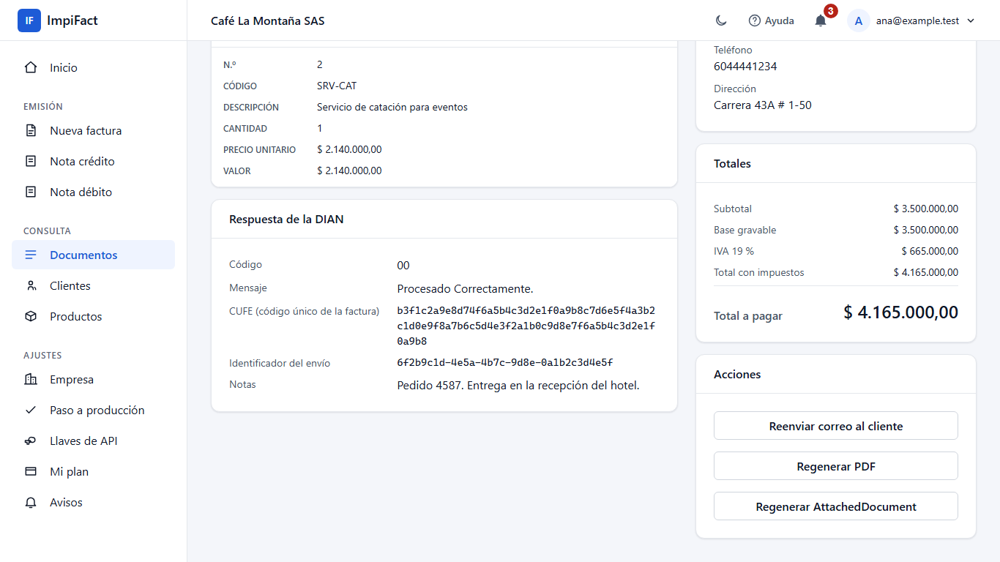

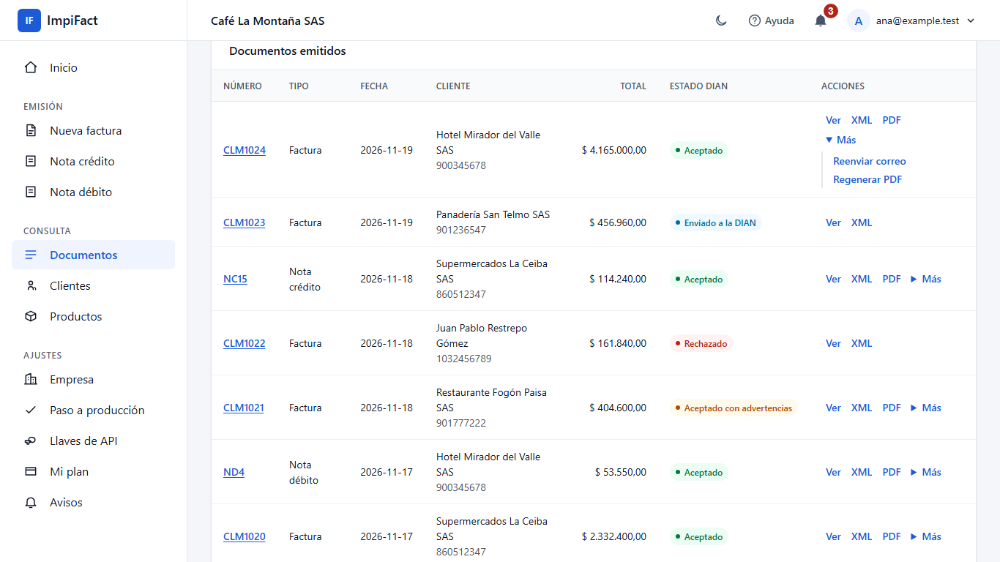

En el celular, el detalle muestra lo mismo en una sola columna, con los botones de descarga a mano.

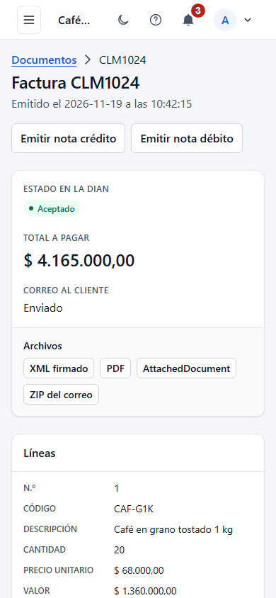

## Tablero, avisos, llaves de API y plan

### Tablero

Al ingresar, el dueño y el vendedor ven el **Tablero** de la empresa activa (la pantalla «Inicio»):

- **Documentos del mes**, **Aceptados por la DIAN**, **Rechazados o con error** y **Vigencia del certificado**.
- **Últimos 12 meses**: documentos por mes. «Ver los datos en una tabla» muestra las mismas cifras en una tabla.
- **Documentos** del mes por estado.
- **Plan**: el consumo del periodo.
- **Certificado de firma**: cuándo vence. Si vence pronto, el panel lo resalta y dice «Renuévelo pronto.».
- **Resoluciones por agotarse**: resoluciones con pocos números o por vencer.

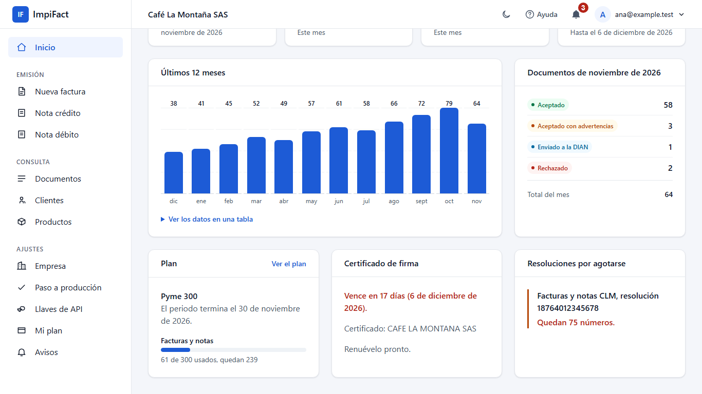

### Avisos

La campana de la barra superior muestra cuántos avisos sin leer tiene. ImpiFact avisa, entre otras cosas, cuando la DIAN rechaza un documento, cuando el certificado está por vencer y cuando una resolución se está quedando sin números o por vencer.

1. Haga clic en la campana para ver los últimos avisos.
2. «Marcar como leído» marca un aviso; «Marcar todos como leídos», todos.
3. «Ver todos los avisos» abre la página **Avisos** (también en la barra lateral), donde **Mostrar** filtra «Todos» o «Sin leer».

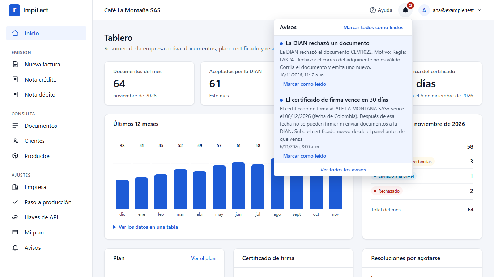

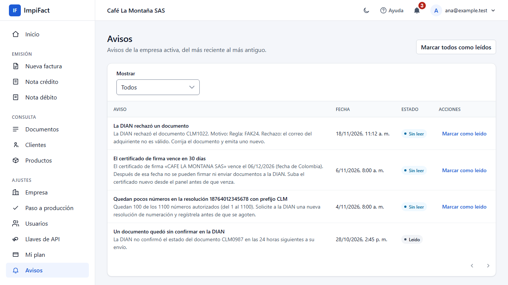

### Llaves de API

Las llaves de API permiten que sus otros sistemas (tienda en línea, ERP) emitan y consulten documentos de esta empresa sin usar el panel. Las usa quien hace la integración.

1. En la barra lateral, haga clic en «Llaves de API».
2. En **Nueva llave**, escriba el **Nombre de la llave** (para reconocerla después, por ejemplo «Tienda en línea»).
3. Marque los **Permisos**: «Consultar documentos y descargar sus archivos», «Emitir documentos (facturas y notas)» o «Cambiar la configuración de la empresa». Solo puede dar los permisos que usted tiene.
4. Si quiere que venza, escriba o elija en el calendario la fecha en **Vence el (opcional)**.
5. Haga clic en «Crear llave».
6. En el diálogo **Copie su llave ahora**, haga clic en «Copiar llave», guárdela en un lugar seguro y haga clic en «Ya la copié».

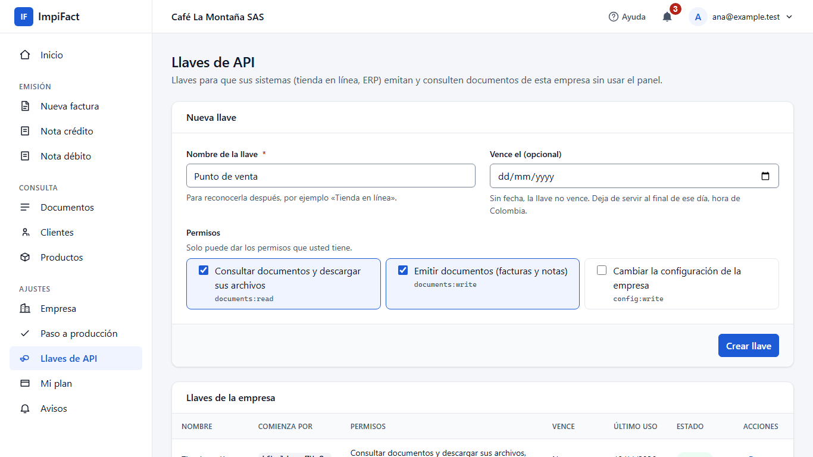

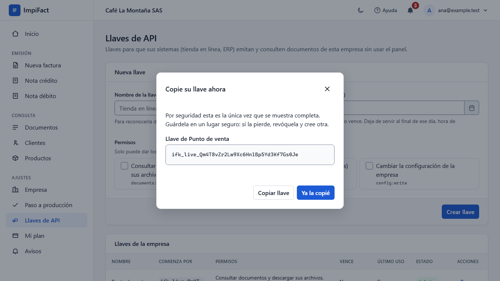

> **Importante:** por seguridad, esta es la única vez que la llave se muestra completa. Si la pierde, revóquela y cree otra.

La tabla **Llaves de la empresa** muestra cómo comienza cada llave, sus permisos, su vencimiento, su último uso y su estado. Con «Revocar», la llave deja de funcionar en máximo un minuto y los sistemas que la usen ya no podrán conectarse.

> **Advertencia:** revocar una llave no se puede deshacer.

### Mi plan

En la barra lateral, haga clic en «Mi plan» para ver el plan contratado por la empresa, su periodo y estado, y los **Documentos del periodo**: cuántos ha usado y cuántos le quedan de cada familia. El consumo sube cuando la DIAN acepta un documento.

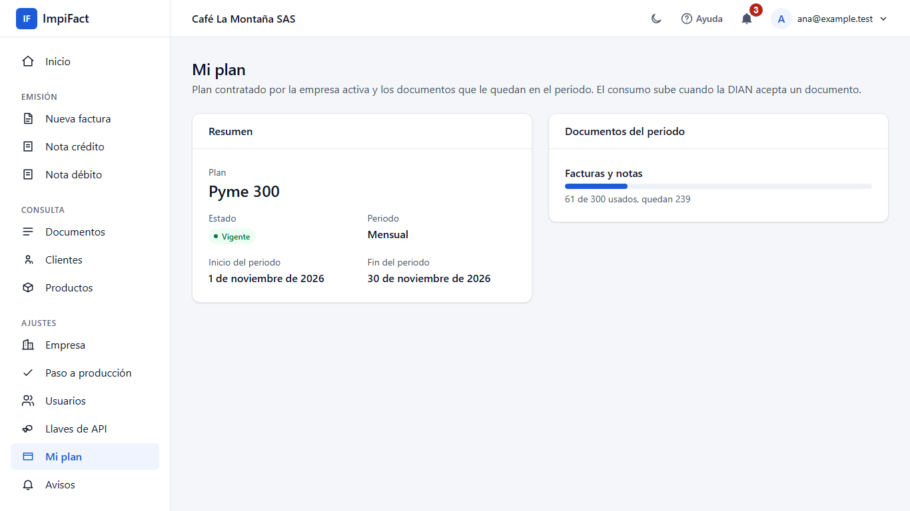

Si la empresa no tiene un plan contratado, comuníquese con su proveedor de ImpiFact.

## Preguntas frecuentes y solución de problemas

### La DIAN rechazó un documento

Recibirá el aviso «La DIAN rechazó un documento» y el documento quedará en estado «Rechazado».

1. Abra el detalle del documento.
2. Lea el código y el mensaje en **Respuesta de la DIAN**: indican la regla que no se cumplió.
3. Corrija el dato (por ejemplo, el correo del cliente en su ficha o los datos de la empresa).
4. Emita un documento nuevo.

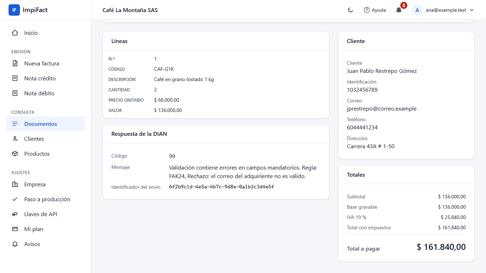

### El certificado está por vencer

El tablero muestra los días que le quedan al certificado y ImpiFact le envía un aviso antes de que venza. Pida el certificado nuevo a su entidad de certificación y cárguelo en «Empresa» > «Certificado». Después de la fecha de vencimiento no se pueden firmar ni enviar documentos a la DIAN.

### La resolución se está agotando o va a vencer

El tablero la muestra en **Resoluciones por agotarse** y ImpiFact le envía un aviso. Solicite a la DIAN una nueva resolución de numeración y regístrela en «Empresa» > «Resoluciones» antes de que se agoten los números o termine la vigencia.

### Se acabaron los documentos del plan

Cuando la empresa usa todos los documentos de su plan, la emisión se rechaza. Revise el consumo en «Mi plan» y comuníquese con su proveedor de ImpiFact para renovarlo o cambiarlo.

### Mi sesión se cerró sola

Para proteger su información, si pasa un tiempo sin actividad el panel muestra el aviso **Su sesión se cerrará por inactividad**. Haga clic en «Seguir conectado» para continuar.

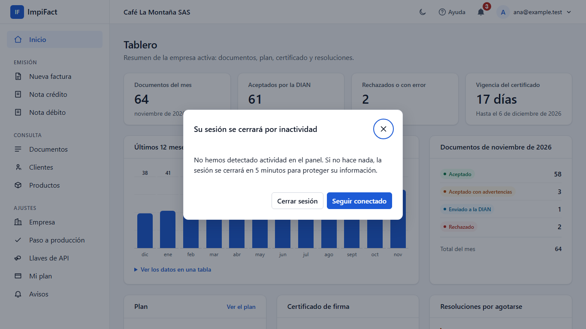

Si no responde, la sesión se cierra y el panel muestra «Su sesión se cerró por inactividad. Inicie sesión de nuevo para continuar.». Ingrese otra vez con su correo y su contraseña.

### No veo una sección del menú

La barra lateral solo muestra las secciones que su rol permite (vea «Quién hace qué»). Si necesita otra, pida al dueño de la empresa que revise su usuario.
